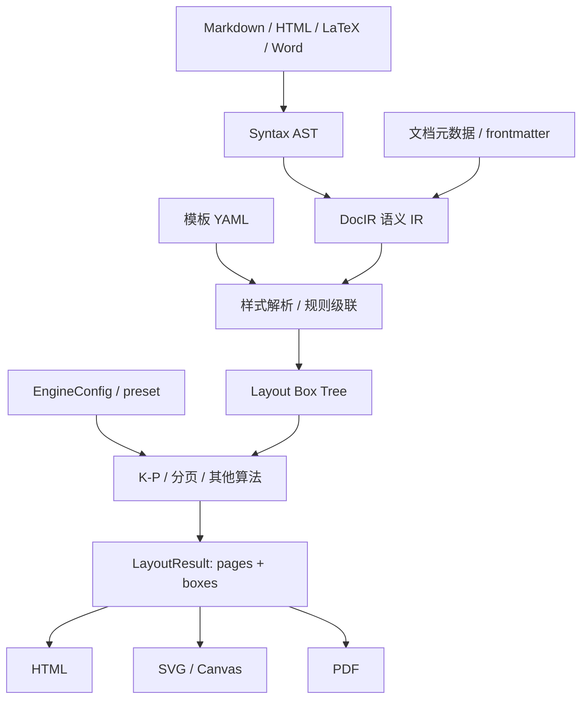

# 架构 v2：内容无关、模板驱动、可验证的排版流水线

状态：**已拍板并冻结（2026-11-20）**。变更必须通过新的 ADR；本文件不改变已冻结的代码契约。
范围：Phase 2 及以后。K1–K8 的段落级 K-P 内核视为已验证资产，不重写。
决策记录：`docs/adr/`（ADR-0001 … ADR-0009）。

---

## 0. 一句话结论

保留已经验证的 **行内 K-P 内核**，在它上面增加三层：

1. **语义 IR（DocIR）**：只描述内容与语义，不出现行宽、字体、页面；
2. **模板/样式解析**：把模板、文档元数据和语义角色解析成计算样式；
3. **布局盒子树 + 分页**：把计算样式和度量结合成物理盒子，K-P 与断页只在这一层工作。

语法前端（Markdown/HTML/LaTeX/Word）只负责产出 DocIR；模板负责“设计”，引擎配置负责“算法行为”。两者不能混在一个文件里。

---

## 1. 现状与问题

当前仓库的流水线是：

```text
文本 -> soma-rules -> Paragraph(Atom + Boundary) -> K-P -> LayoutResult -> HTML demo
```

已经解决：

- 中英混排断行、避头尾、行边 trim、强制换行、行盒、确定性整数输出；
- 暴力最优参考、canonical 字节、native/wasm 同哈希；
- 参数分层、评估工具、demo、WASM fixture。

还没有解决：

- **没有文档模型**：标题、列表、脚注、图、表、公式、章节、封面只存在于 Markdown AST 或渲染器里；
- **没有模板**：段落宽度、缩进、字体、页边距、页眉页脚、封面都写死在调用方；
- **没有布局盒子树**：段落之外没有 VBox/HBox/Glue/Penalty，也没有分页；
- **语法不可扩展**：目前只有文本编译器，HTML/LaTeX/Word 没有统一入口；
- **模板与引擎配置没有边界**：一旦把 tolerance、权重、页边距混在一个配置里，跨端复现和质量门禁都会失效。

这份提案的核心判断是：**“统一 IR”不是一层，而是两层。** 语义 IR 与布局盒子树必须分开，否则模板、语法前端和断行算法会互相污染。

---

## 2. 目标与非目标

### 目标

- **内容无关**：同一份 DocIR 可以被不同语法前端产出；同一份模板可以吃不同来源的内容。
- **模板驱动**：版式由模板定义；内容只表达语义。
- **可扩展语法**：Markdown、HTML、LaTeX 先行，Word 后接；新增语法不改编排核心。
- **可验证**：每层有 canonical 序列化、版本、哈希、golden、跨端哈希。
- **AI 可自动化**：模板是声明式契约，内容槽位、校验、诊断、批处理都可机器读取。
- **保留现有资产**：K-P、代价模型、trim、forced segment、canonical result 不重写。

### 非目标（本阶段不做）

- 完整 Word 排版保真、完整 CSS 引擎、完整 TeX 数学排版；
- 浮动体、多栏、竖排、bidi、整书级全局优化；
- 浏览器富文本编辑器；
- 在核心内解析字体文件、执行脚本、访问网络；
- 用 AI 直接决定断行或页面布局。

---

### 2.1 Clean-room 约束

本架构从 2026-11-20 起按 clean-room 执行：

- 不引用、不复制、不依赖之前那个 Typst 转换项目；它已从工作流中删除。
- 公开参考仅限：PRD、Knuth-Plass 论文、CLReq/GB/T 等规范（引用条款，不复制表格）、Rust 标准库与公开 crate 文档。
- 现有 `soma-core::semantic` 与 `soma-core::text` 是早期种子模块，**不属于冻结架构**；新代码不得依赖它们，`soma-doc` 将以独立设计替代（ADR-0008）。
- 不使用指向旧项目的 path dependency；不把 Typst 依赖树带进任何核心 crate。
- Provenance 记录只登记本仓库新写的代码与公开规范引用，不登记旧项目代码。
- 旧提案/旧执行计划存放在 `docs/archive/`，带 ARCHIVED 头，仅作历史；不作为设计输入。

### 2.2 已拍板的六个方向

1. 模板格式：**纯 YAML**（manifest + style rules），不做 CSS 引擎。
2. HTML 输入：**语义白名单**，忽略表现型 CSS。
3. 分页：**垂直 K-P + 确定性贪心回退**。
4. Word：**只做 import + 样式映射**，不承诺版式保真。
5. DocIR：**新建 `soma-doc`**，迁移语义类型；`soma-core` 保持行内内核，旧 `semantic`/`text` 退出公共 API，不做兼容 re-export。
6. Clean-room：**不再参考旧 Typst 项目**；旧文档归档，旧种子模块隔离。

## 3. 总体流水线



关键约束：

- 语法 AST **不是**统一 IR；它只在前端内部存在。
- 模板解析发生在 DocIR 之后、布局之前；模板看不到源语法，布局看不到模板文件。
- K-P 只认识布局盒子树里的行内序列；它不认识 Markdown、HTML、脚注或封面。
- 渲染器只消费 `LayoutResult`，不得重新断行、重新分页。

---

## 4. 分层契约

| 层 | 拥有者 | 输入 | 输出 | 明确不做 |
|---|---|---|---|---|
| Syntax AST | 各前端 crate | 源文本/字节 | 前端自己的 AST | 不进入公共 API |
| DocIR | `soma-doc` | AST + 元数据 | 语义文档树 | 不出现宽度、字体、页面 |
| Styled Doc | `soma-template` | DocIR + 模板 | 计算样式 + 角色树 | 不做断行、不做分页 |
| Layout Box Tree | `soma-layout` | Styled Doc + Metrics | VBox/HBox/Glue/Penalty | 不解析语法、不读模板文件 |
| LayoutResult | `soma-layout` + `soma-core` | Box Tree + EngineConfig | 页面/行/盒子坐标 | 不做像素、不做字体光栅化 |
| Renderer | `soma-render-*` | LayoutResult + 资源 | HTML/SVG/PDF | 不重新断行、不改坐标 |

每一层都应有独立的 canonical schema 与版本号；跨层只传稳定数据结构，不传解析器私有类型。

---

## 5. 语义 IR（DocIR）

### 5.1 原则

- 只表达“这是什么”，不表达“看起来怎样”。
- 不出现 `width`、`font_size`、`margin`、`color` 这类物理/视觉属性；这些属于模板与计算样式。
- 允许语义角色/类：`role: body | caption | footnote | aside | ...`、`classes: [...]`，供模板规则匹配。
- 所有节点带 `NodeId` 与 `SourceSpan`；诊断、增量重排、跨端调试都依赖它们。
- 未知节点不能丢：`RawBlock`/`RawInline` 保留原始文本、格式、fallback 文本与能力标记。

### 5.2 节点清单（目标形态）

**文档级**

- `Document { meta, sections, blocks, footnotes, source_map }`
- `DocumentMeta`：标题、作者、语言、日期、关键词、模板引用、封面数据。
- `Section`：章节层级、编号、页面模板引用、分节符。
- `FootnoteDef { id, blocks }`、`FootnoteRef { id }`
- `Toc`、`Index`、`Bibliography`（后续）
- `PageBreak`、`SectionBreak`

**块级**

- `Paragraph { inline, role }`
- `Heading { level, inline, role }`
- `List { ordered, start, items }`、`ListItem`
- `BlockQuote`
- `CodeBlock { lang, value }`
- `MathBlock { source }`
- `Figure { image, caption, label }`
- `Table { columns, rows, caption }`
- `ThematicBreak`
- `RawBlock { format, value, fallback }`
- `GeneratedBlock`（目录、索引、封面槽位等，由模板/文档阶段生成）

**行内**

- `Text`
- `Strong`、`Emphasis`、`Underline`、`Strikethrough`、`SmallCaps`
- `Superscript`、`Subscript`
- `Code`
- `Link { href, title, children }`
- `Image { src, alt, title, intrinsic? }`
- `MathInline { source }`
- `FootnoteRef`
- `RawInline { format, value, fallback }`
- `Ruby { base, annotation }`（后续）
- `LineBreak { kind: Soft | Hard }`（也可由段落构建阶段消费）

### 5.3 语义与呈现的边界

这是最容易出错的地方，建议拍板以下规则：

1. **内容只表达语义。** `**bold**`、`<u>`、`\underline` 分别变成 `Strong`、`Underline`；不是“字重 700”或“下划线 1px”。
2. **模板决定呈现。** 模板可以选择 `Strong` 用粗体、颜色或小型大写；但默认不得静默丢弃语义。
3. **内容里的表现型 HTML/CSS 不进入 DocIR。** 例如 `<span style="font-size:20px">` 不应直接改变字号；前端应把它映射为 `role/class` 或拒绝并给诊断。
4. **模板可以“弱化”但不能“伪装”。** 若模板把 `Strong` 设为正常字重，DocIR 仍保留 `Strong`；评估和可访问性仍能看到语义。
5. **缺失语法不是错误。** Markdown 没有下划线，不代表 DocIR 不能有；HTML/LaTeX 可以补。前端只需要声明自己的能力矩阵。

### 5.4 扩展机制

- `DocIR` 使用带版本的 schema；新增节点类型 = 新 `docIrVersion`。
- 前端注册 `NodeKind` → 语义映射；未知节点落到 `Raw*`，不 panic。
- 模板规则只匹配已声明的节点/角色；未知属性给警告，不猜测。
- 所有枚举都允许未来扩展，但 canonical writer 必须在旧 reader 中保持稳定；未知字段策略要写进 schema 文档。

---

## 6. 语法前端

### 6.1 统一入口

```rust
pub trait SyntaxFrontend {
    type Ast;
    fn id(&self) -> &'static str;
    fn capabilities(&self) -> CapabilitySet;
    fn parse(&self, source: &Source) -> Result<Self::Ast, Diagnostic>;
    fn to_doc_ir(&self, ast: Self::Ast) -> Result<Document, Diagnostic>;
}
```

- `SyntaxDocument` 是前端私有类型；公共 API 只暴露 `to_doc_ir`。
- `CapabilitySet` 声明支持哪些语义节点（如 `underline`、`math`、`footnote`），供模板和诊断使用。
- 新增语法 = 新 crate + 注册；不修改 `soma-doc` 或 `soma-layout`。

### 6.2 首批前端

| 前端 | 解析器 | 首版范围 | 明确不做 |
|---|---|---|---|
| `soma-md` | 自研子集；嵌入片段复用 `soma-html` / `soma-latex` | CommonMark 基础、GFM 表格/删除线、行内/行间数学、语义 HTML、LaTeX 命令与环境 | 完整 CommonMark 边界、扩展语法全集、行内 LaTeX 脚注定义 |
| `soma-html` | `html5ever`/`scraper` | 语义白名单：标题、段落、列表、强调、链接、图、表、脚注、上下标、`u`/`s`、`ruby` | 不执行 CSS 布局；不执行脚本 |
| `soma-latex` | 自研子集或成熟解析器 | 标题、段落、强调、下划线、上下标、公式、脚注、图、表、引用 | 不实现完整 TeX 宏展开 |
| `soma-docx` | docx XML/zip | 段落样式、字符样式、标题、列表、脚注、图、表 | 不做 Word 版式保真 |

### 6.3 映射示例

| 语法 | DocIR | 模板可做的事 |
|---|---|---|
| Markdown `**x**` | `Strong(Text("x"))` | 粗体/颜色/小型大写；不能删语义 |
| HTML `<u>x</u>` | `Underline(Text("x"))` | 选择下划线样式/颜色；不能变成删除线 |
| LaTeX `\underline{x}` | `Underline(Text("x"))` | 同上 |
| Markdown 行尾两个空格 | `LineBreak(Hard)` | 强制换行；不重新缩进 |
| Markdown `$x$` / `$$x$$` | `MathInline` / `MathBlock` | 数学布局适配器；字体/大小 |
| HTML `<span class="note">x</span>` | `Text` + `role/class="note"` | 通过样式规则设置段落/字符样式 |
| 未知 HTML 标签 | `RawInline` + fallback | 诊断；可降级为文本 |

原始 HTML/LaTeX 的处理策略：

- **可识别且语义明确**：转成 DocIR 节点。
- **不可识别**：保留为 `Raw*`，带 `fallback_text`；布局用 fallback 的度量，渲染器可选择原样输出或降级。
- **安全**：不执行脚本、不访问网络、不读本地文件；模板资源由宿主注入；原始节点在 HTML 输出时按白名单/转义策略处理。

---

## 7. 模板模型（纯 YAML）

### 7.1 模板不是引擎配置

| | 模板（Template） | 引擎配置（EngineConfig） |
|---|---|---|
| 回答的问题 | 这份文档长什么样 | 算法怎么跑 |
| 内容 | 页面、边距、字体、样式、封面、页眉页脚、脚注、编号 | tolerance、权重、fallback、窗口、max_kp_atoms、feature flags |
| 谁改 | 设计师/文档作者/AI 生成后校验 | 引擎开发者/高级用户 |
| 版本 | `templateVersion` + `templateHash` | `preset` + `paramHash` |
| 能否影响断行 | 只能通过样式（宽度、字体、行高）间接影响 | 直接决定算法行为 |
| 能否包含算法旋钮 | **不能**；出现即校验错误 | 只在这里 |

模板文件：

```text
template.yaml        # 单文件：页面、封面、目录、编号、样式规则、母版
```

它是一份纯 YAML 数据，不是 CSS，也不是可执行脚本；字体与图片由宿主通过
CLI/度量表注入，模板只声明族名、字号与样式。参考实现见
`examples/templates/plex.yaml`。

### 7.2 模板示例（当前实现）

早期设计把模板拆成 `manifest.yaml` + `styles.yaml`，并带一个 `schema:` 字段。
实现按 ADR-0003/0009 收敛为**一份纯 YAML 文件**；版本由 `soma.template/9`
常量标识，文件里不再写 `schema:`。实际形状如下（完整字段见
[`docs/template.md`](template.md)）：

```yaml
name: book-a5
version: "1"

page:
  size: A5
  margin: 16mm
  margin-top: 18mm
  header: 6mm
  footer: 6mm
  header-text: running-title
  folio: "{page}"
  start-master: chapter
  front-matter: roman

cover:
  master: cover

toc:
  depth: 2
  title: 目录

styles:
  - selector:
      element: paragraph
      role: body
    declarations:
      font-size: 10.5pt
      line-height: 1.6
      first-indent: 2em
      align: justify

  - selector:
      element: heading
      level: 1
    declarations:
      font-size: 20pt
      line-height: 1.3
      space-before: 18pt
      space-after: 12pt
      keep-with-next: true
```

规则模型是**数据驱动的 YAML 规则表**，不是 CSS：

- `selector` 字段：`element`、`role`、`class`/`classes`、`level`、`lang`、
  `section`、`page-master`、`within`。
- `declarations` 字段：字体族/字重/字形/字号、行高、段前段后、首行缩进、对齐、
  断页/保持、孤行寡行、下划线/删除线、上下标、颜色（渲染层）。
- 可选 `priority` 整数（默认 0）；`priority` 高者覆盖低者，同 `priority`
  按列表顺序后者覆盖前者。
- 不支持 CSS 选择器、组合、伪类、媒体查询、CSS 函数或脚本。
- 未知属性 → 诊断；不静默忽略。
- 级联顺序：引擎默认 < 模板 base < 模板 rules < 文档级命名角色（可选）。内容里的表现型属性不参与。

### 7.4 单位与确定性

模板会写 `10.5pt`、`18mm`、`1.6` 这类小数。核心必须保持整数：

- 模板解析器把十进制字符串解析成有理数，再按固定比例转成 `1/4096 em` 或 `1/4096 pt`；
- 舍入规则固定（建议 round-half-up），并在 `templateVersion` 中锁定；
- 禁止 `f32/f64` 进入布局；模板解析可以在边缘用十进制/有理数；
- 百分比相对于父级/页面内容宽度，解析时物化，不保留浮点。

### 7.5 模板槽位与“AI 时代”

模板是内容与版式之间的契约：

- **内容槽位**：`cover`、`toc`、`body`、`footnote-area`、`running-header` 等；每个槽位声明 required/optional、接受的块类型、fallback。
- **校验**：加载时检查页面尺寸、字体引用、规则、槽位、循环引用；缺必需槽位直接报错。
- **诊断**：机器可读的 `code/severity/span/message`，AI 或 CI 可以自动修复/重试。
- **哈希**：`templateHash` 覆盖 manifest、styles、字体引用和资源清单；同内容 + 同模板 + 同度量 = 同输出。
- **AI 生成模板**：AI 可以生成 manifest/styles，但必须通过 schema 校验与渲染回归；核心不“理解”设计意图。

### 7.6 文档 frontmatter

Markdown YAML frontmatter 属于**文档元数据**，不是模板：

- 可以声明 `title/author/lang/template: book-a5`、封面字段、章节元数据；
- 不能写 tolerance、权重、页边距、字体文件路径；
- 若 frontmatter 与模板冲突，模板的结构/页面设置优先，文档只提供内容与元数据；需要覆盖时用命名角色，而不是模板外部的原始样式。

---

## 8. 布局盒子树

### 8.1 为什么需要第三层

`DocIR + 模板` 仍然不是物理布局：

- 一个段落需要知道宽度、首行缩进、行高、字体度量；
- 一个页面需要知道内容高度、页眉页脚、脚注区；
- 一个标题可能需要“与下一段保持同页”；
- 一个图需要固有尺寸与缩放。

这些都属于 **Layout Box Tree**，不属于 DocIR，也不属于模板文件。

### 8.2 盒子类型

```rust
pub enum LayoutNode {
    VBox(VBox),          // 文档、页面、章节、列表、表格行
    HBox(HBox),          // 行、行内组合
    Paragraph(ParagraphBox),
    TextRun(TextRun),    // 已 shaping 的 glyph run
    Image(ImageBox),
    Math(MathBox),
    Rule(RuleBox),
    Glue(Glue),
    Penalty(Penalty),
    FootnoteArea(FootnoteArea),
    PageBreak(PageBreak),
}
```

- `ParagraphBox` 内部仍是当前的 `Atom + Boundary` 行内序列；现有 K-P 直接复用。
- `VBox` 负责垂直堆叠、分页点、keep-with-next、孤行寡行。
- `Glue/Penalty` 是垂直/水平胶与罚分；所有断点都是显式的。
- `TextRun` 是 shaping 之后的输出；核心只读 advance/ascent/descent，不打开字体。

### 8.3 段落构建

```text
DocIR Paragraph + ComputedStyle
  -> soma-rules: 分段、标点类、禁断/强制、gap/trim
  -> InlineSequence (Atom + Boundary, StyleId)
  -> MetricsProvider: advance / line metrics
  -> soma-core::break_paragraph
  -> Line boxes
  -> ParagraphBox
```

- 现有 `soma-rules` 继续负责中文规则；它不知道模板，只接收计算后的 `StyleId` 和度量上下文。
- 样式切换（`Strong`/`Emphasis`/`Underline`）在 `Atom` 上体现为不同 `StyleId`，词内切换强制 `Forbidden`。
- 下划线/删除线不是断行属性，进入行内装饰；不影响 K-P。
- 上下标通过 baseline shift + 字号样式进入 `Metrics`。

### 8.4 分页

分页是垂直方向的全局优化。建议：

- **垂直 K-P**：VBox 中的 `Glue/Penalty` 构成断点；页面剩余空间产生 badness；孤行寡行、keep-with-next 用硬约束/高 penalty。
- 页面模板（first/body/left/right）作为状态的一部分；换页可以切换页眉页脚/页边距。
- 没有可行解时回退到确定性贪心 + 诊断，不 panic。
- 分页 DP 的状态数远小于行内 DP；仍要设置上限与确定性 tie-break。

### 8.5 脚注

脚注是分页的耦合项：

1. 先按当前脚注预留高度排版页面；
2. 收集本页脚注引用，排版脚注区；
3. 若脚注区高度变化，回到 1，更新预留高度；
4. 设定最大迭代次数（如 8）；未收敛则使用最后一次结果并给出诊断。

- 脚注编号、每页重置/连续编号由模板决定。
- 脚注区分栏、脚注内再断行仍复用行内 K-P。
- 不建议在 MVP 做“脚注跨页拆分”；先整块移到下一页。

### 8.6 图、表、公式

- **图**：`ImageBox` 带固有尺寸/宽高比；首版只做块级/行内放置，不做浮动绕排。
- **表**：语义表格 → 列宽算法（固定/自动）→ 单元格段落 → 垂直/水平线；首版可限制为简单表格。
- **公式**：`MathBox` 由 `MathLayout` 适配器给出宽高/基线；核心不实现 TeX 数学。没有适配器时降级为文本 + 诊断。
- **浮动体**：接口预留，MVP 不做。

### 8.7 页面与 running header

- `Page` 有页面模板、内容区、页眉/页脚槽位、页码、脚注区。
- 页眉/页脚是模板生成的 VBox，可引用章节标题、页码、文档元数据。
- 章节切换可以切换页面模板；封面/目录是模板生成的页面，不是特殊布局分支。

---

## 9. 引擎配置

```yaml
schema: soma.engine/1
preset: default-v1
window: paragraph        # paragraph | page | chapter
max_kp_atoms: null
fallback:
  allow_emergency: true
  allow_forbidden: true
```

- `EngineConfig` 只影响算法行为；模板不能写这些字段。
- `preset` 继续是 `default-v1` 这类冻结参数集；改默认值要换 preset id。
- `window` 决定 K-P 的搜索范围；首版仍是 `paragraph`，分页层引入 `page`。
- 所有配置进入 `paramHash`；结果只在同一 `(preset, rulesVersion, metricsVersion, engineHash, fallbackStage)` 下可比。

---

## 10. 算法与确定性

- **行内 K-P**：保留现有实现、代价模型、trim、forced segment、fallback ladder。
- **分页**：垂直 K-P（推荐）或确定性贪心 + widow/orphan；两者共用同一个垂直代价模型。
- **窗口调度**：段落 → 页 → 章；窗口只改变搜索范围，不改变代价定义。
- **确定性**：整数定点、无浮点、固定迭代顺序、固定 tie-break、固定脚注迭代上限。
- **性能**：行内已有 atom 数窗口；分页用页数/盒子数窗口；缓存键为 `(contentHash, templateHash, metricsHash, engineHash)`。
- **增量**：后续按 NodeId 做局部重排；首版不做。

---

## 11. 渲染适配器

渲染器只消费 `LayoutResult`：

```text
LayoutResult
  pages[]
    page-template, content-box, header/footer boxes
    lines[] / boxes[] / glyph runs
    footnote-area
    style table (StyleId -> computed style)
```

- HTML：绝对定位 `div/span`，`white-space: pre`，不重新断行。
- SVG/Canvas：按坐标绘制，字体由宿主提供。
- PDF：后续适配器，使用同一坐标。
- 颜色、字体文件、下划线装饰由渲染器解析 `ComputedStyle`；核心只给几何与样式 ID。
- 渲染器不得修改断点、行宽、页高。

---

## 12. 版本、哈希与 canonical 格式

建议每个层都有独立版本：

| 层 | 版本/哈希 |
|---|---|
| 语法前端 | `syntaxId` + `syntaxVersion` |
| DocIR | `docIrVersion` + `documentHash` |
| 模板 | `templateVersion` + `templateHash` |
| 样式解析 | `styleVersion` + `styleHash` |
| 行内布局 | `layoutModelVersion` + `rulesVersion` + `metricsVersion` + `paramHash` |
| 分页 | `paginationVersion` + `pageModelHash` |
| 渲染 | `rendererVersion` |

规则：

- canonical JSON 字段顺序固定，整数单位，字符串枚举。
- 未知字段策略写进 schema；跨版本不比较字节。
- 同内容 + 同模板 + 同度量 + 同引擎配置 → 同字节。
- native 与 `wasm32-wasip1` 同哈希；当前已有 fixture 门禁，扩展到完整管线。

---

## 13. 测试与门禁

| 层 | 测试 |
|---|---|
| 语法前端 | CommonMark/HTML/LaTeX 子集 golden；能力矩阵；未知节点降级 |
| DocIR | canonical golden；source span；未知节点保留 |
| 模板 | 规则优先级；单位换算；非法属性；槽位校验；hash |
| 布局盒子 | 盒子树 golden；段落 K-P 复用；宽度/基线不变量 |
| 分页 | 页面覆盖完整；孤行寡行；keep-with-next；页脚高度；确定性 |
| 脚注 | 收敛迭代上限；编号；跨页策略 |
| 渲染 | 绝对坐标；不重排；HTML/SVG/PDF 一致性 |
| 跨端 | native/wasm 同哈希；无浮点；依赖守卫 |
| 质量 | Gate Q 仍只对 `Verified` 规则做断言；`Tbd` 只报告 |

新增 Gate（建议）：

- **Gate A（架构）**：层间依赖、schema 版本、模板不能写引擎旋钮。
- **Gate C（内容）**：输入能力矩阵、未知语法降级、raw 安全。
- **Gate R（渲染）**：同 LayoutResult 在不同渲染器坐标一致。

---

## 14. AI 时代的自动化要求

- **内容与设计分离**：内容由任意受支持语法产生；模板由设计者/AI 生成；引擎只做确定性解析。
- **契约化模板**：槽位、必需字段、接受节点类型、fallback 全部可校验。
- **机器可读诊断**：`code/severity/span/message/fixHint`；CI/Agent 可以自动修复或重试。
- **批处理/服务化**：`soma-cli render --template ... --input ... --format html`；输出 canonical JSON + 资源清单。
- **可复现**：内容 hash、模板 hash、度量 hash、引擎 hash 全部记录。
- **安全**：模板/内容不执行脚本、不访问网络；原始 HTML/LaTeX 有白名单与降级策略。
- **不做**：让 AI 直接输出断点或页面坐标；核心仍是唯一布局真相。

---

## 15. Crate 结构与迁移

### 15.1 建议结构（分阶段落地）

```text
crates/
  soma-core/        # units, metrics seam, inline K-P, canonical line result
  soma-rules/       # segmentation + CJK punctuation/gap/trim -> inline sequence
  soma-highlight/   # code lexer -> SyntaxClass spans (ADR-0091)
  soma-tikz/        # core PGF drawing language -> integer vector paths (ADR-0092)
  soma-diagram/     # Mermaid/DOT -> the same integer vector box (ADR-0102)
  soma-doc/         # DocIR, source map, document schema
  soma-template/    # manifest, YAML style rules, validation, page masters
  soma-layout/      # box tree, paragraph adapter, pagination, footnotes
  soma-math/        # TeX subset -> integer math boxes
  soma-metrics/     # soma.metrics/7 table reader + adapters
  soma-md/          # Markdown -> DocIR, with embedded LaTeX/HTML fragments
  soma-html/        # HTML -> DocIR
  soma-latex/       # LaTeX subset -> DocIR
  soma-docx/        # Word .docx -> DocIR
  soma-render-html/ # LayoutResult -> HTML
  soma-render-svg/  # LayoutResult -> SVG
  soma-render-pdf/  # LayoutResult -> PDF
  soma-engine/      # soma.engine/1 configuration
  soma-collate/     # pinyin order for the index
  soma-hyphen/      # Liang hyphenation
  soma-web/         # browser C ABI slice (rules + K-P)
  soma-wasm/        # native/WASI fixture for byte parity
  soma-eval/        # benchmark, sweeps, blind statistics, scorecard
  soma-demo/        # static HTML renderer
  soma-cli/         # `soma` binary
```

最初建议先落地五个 crate；现在上表 24 个已全部落地，且 `soma-core` 保持
最底层的依赖边界（ADR-0007/0009）。

### 15.2 迁移顺序

1. **冻结 K-P 内核**：不再往 `soma-core` 塞文档/模板类型；只修 bug。
2. **把语义类型迁到 `soma-doc`**：当前 `soma-core::semantic` 作为旧种子；**不保留公共 re-export**，A1 直接删除旧模块与导出。新代码只使用 `soma-doc`。
3. **模板骨架**：manifest/styles 的 schema、解析器、校验、hash；先支持页面/段落/标题/行内语义。
4. **布局盒子树**：把当前 `Paragraph` 包进 `ParagraphBox`；先只做单页，复用 K-P。
5. **分页**：VBox/Penalty/页面模板/页眉页脚；再做脚注迭代。
6. **语法前端**：`soma-md`（comrak）→ `soma-html` → `soma-latex`；Word 最后。
7. **渲染与 wasm**：HTML 渲染器消费页面结果；native/wasm 全管线哈希。
8. **图表公式**：图/表先简单版；数学用适配器；浮动体最后。

### 15.3 兼容策略

- 旧 `break_paragraph` / `LayoutResult` 保持可用，供 K-P 回归和现有 demo。
- 新管线在 `soma-layout` 中包一层；不把旧 API 改成新 API。
- schema 版本独立；旧 canonical 结果与新页面结果不比较字节。

---

## 16. 风险与取舍

| 风险 | 影响 | 对策 |
|---|---|---|
| 模板 DSL 变成半个 CSS | 实现/维护失控 | 受控 YAML rules + typed properties；未知属性报错 |
| 语义与呈现混淆 | 模板无法统一设计 | DocIR 只留语义；内容表现型属性拒绝或映射为 role |
| 分页/脚注复杂度爆炸 | 首版拖死 | 先整块脚注、单栏、无浮动；迭代上限 + 诊断 |
| Word 保真不可达 | 承诺过度 | Word 只做 import + 样式映射，不承诺版式一致 |
| 字体/shaping 依赖 | 核心膨胀 | `Shaper`/`MetricsProvider` seam；核心不解析字体 |
| 原始 HTML/LaTeX 安全 | XSS/资源滥用 | 白名单、转义、无脚本/网络、资源上限 |
| 跨端差异 | G4 失败 | 整数、canonical、native/wasm 全管线哈希 |
| 模板/内容版本漂移 | 无法复现 | templateHash + documentHash + engineHash 全记录 |
| 过度设计/提前抽象 | 工期 | 分阶段；每层先做最小可用 schema，再扩展 |

---

## 17. 已拍板决策（冻结）

| # | 决策 | 结果 |
|---|---|---|
| 1 | 模板格式 | **纯 YAML manifest + YAML rules**；不做 CSS 引擎 |
| 2 | HTML 输入策略 | **语义白名单**；忽略表现型 CSS；raw 降级 + 诊断 |
| 3 | Word 范围 | **只做 import + 样式映射**；不承诺 Word 版式保真 |
| 4 | 分页算法 | **垂直 K-P 优先**，无解回退确定性贪心；不做时间型 fallback |
| 5 | 脚注策略 | 首版整块脚注、每页重排收敛；不做脚注跨页拆分 |
| 6 | 数学 | **MathLayout 适配器**；核心不实现 TeX 数学 |
| 7 | 模板覆盖范围 | 模板只能通过命名角色/YAML 规则影响样式；内容不得写原始样式 |
| 8 | Crate 拆分 | 先 5 个新 crate；不一次性拆 20 个 |
| 9 | DocIR 迁移 | **新建 `soma-doc`**；旧 `semantic`/`text` 退出公共 API，不做兼容 re-export |
| 10 | 旧 K-P API | **冻结并复用**；新管线包一层，不重写 |
| 11 | Clean-room | **不再参考旧 Typst 项目**；旧文档归档，种子模块隔离 |
| 12 | 架构状态 | **冻结**；变更必须新增 ADR |

---

## 18. 冻结后的执行顺序

架构已冻结，下面只是实现顺序；任何偏离都要新 ADR：

- **A0**：ADR + DocIR/Template schema v1（本步）。
- **A1**：`soma-doc`（语义节点 + source span + canonical JSON）。
- **A2**：`soma-template`（纯 YAML manifest/rules + 单位换算 + 校验 + hash）。
- **A3**：`soma-layout`（ParagraphBox 包装现有 K-P；单页）。
- **A4**：分页 + 页面模板 + 页眉页脚。
- **A5**：`soma-md`（comrak）+ `soma-render-html`，打通 MD → DocIR → 模板 → 盒子 → 页面 → HTML。
- **A6**：脚注、图、表、公式适配、全管线 native/wasm 哈希。

每步都要有 canonical golden、错误诊断和 Gate 检查；K-P 内核保持冻结。

---

## 19. 冻结与变更流程

- 本文件与 ADR-0001…0009 于 2026-11-20 冻结。
- 已接受的 ADR 不修改决策；需要变更时新增 ADR，并在新 ADR 中写 `Supersedes`。
- 架构变更必须先有新 ADR，再改代码；ADR 需要说明对已实现 K1–K8 代码的影响。
- `scripts/gates.sh` 的 clean-room 检查会阻止活跃文件重新引用已删除的旧项目。
- 归档文档（`docs/archive/`）不作为设计输入，也不参与门禁。

---

## 附录 A：一条完整示例

```text
Markdown:
  # 第一章
  中文 **加粗** 与 [链接](https://example.com)，行尾两个空格  
  强制换行。脚注[^1]。
  [^1]: 脚注内容。

DocIR:
  Heading(level=1, Text("第一章"))
  Paragraph([
    Text("中文 "), Strong(Text("加粗")), Text(" 与 "),
    Link(href=..., Text("链接")), Text("，行尾两个空格"),
    LineBreak(Hard), Text("强制换行。脚注"), FootnoteRef("1"), Text("。")
  ])
  FootnoteDef(id="1", Paragraph(Text("脚注内容。")))

Template:
  body: 10.5pt serif / 1.6 line-height / 2em first-indent / justify
  h1: 20pt sans / keep-with-next
  footnote: 8pt / 1.35 line-height

Layout:
  ParagraphBox -> soma-rules -> InlineSequence -> K-P -> lines
  VBox(page body) -> vertical K-P -> page 1 + footnote area
  LayoutResult -> HTML absolute spans
```

这条链路就是本提案要保证的“内容无关、模板驱动、可验证”。
