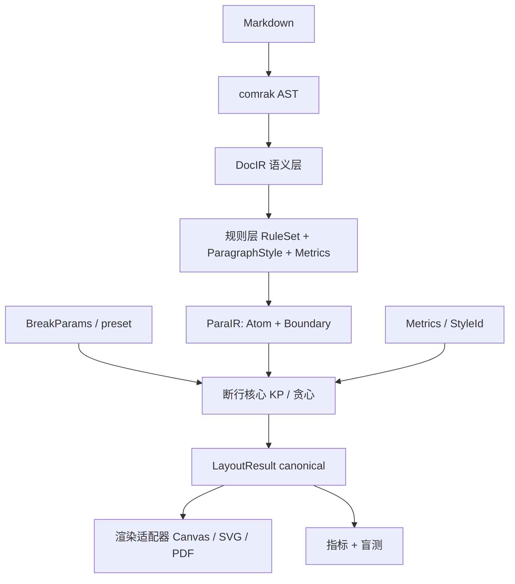

> **ARCHIVED 2026-11-20 — LEGACY, NOT NORMATIVE.** Superseded by `docs/architecture-v2.md` and `docs/adr/`. This document references a deleted prior project and must not be used as clean-room design input.

# 主提案：参数化中文优先排版核心（Phase 1）

**对应 PRD：** 项目简报（未随仓库分发）
**参考实现：** [`somadoc-engine`](somadoc-engine/README.md)（v0.1.0 + wasm 支持，commit `32424f1`）
**详细 K-P 模型：** [`soma-typeset/docs/kp-model.md`](soma-typeset/docs/kp-model.md)
**参数系统：** [`soma-typeset/docs/params.md`](soma-typeset/docs/params.md)
**当前代码：** [`soma-typeset/`](soma-typeset/README.md)（K1 前的可运行参考实现）

---

## 0. 一页结论

**做什么：** 一个与运行时无关、参数化、以中文与中英混排为第一公民的排版核心。输入 `DocIR`，经规则层编译为 `ParaIR`（atom + boundary），用 Knuth-Plass 全局 DP 断行，输出确定性的 `LayoutResult`；浏览器、移动端、PDF/阅读器只做渲染适配。

**怎么做：**

1. **两级 IR：** `DocIR`（语义）与 `ParaIR`（可断行原子 + 边界）分离；断行单元是一等属性。
2. **规则与算法分离：** 中文规则在规则层编译成禁断、glue、stretch/shrink、trim、penalty；breaker 保持脚本无关。
3. **参数化：** 结构常量 / 规则比例 / 代价权重 / 样式度量 / 段落几何 / 评估协议六层分离；默认值只是 `default-v1` preset，不写死在算法里。
4. **加法加权代价：** `line + badness + break_penalty + compression + boundary_deviation + short_last + height + emergency`，每项独立权重。
5. **确定性：** 整数定点（1/4096 base em），无浮点；`modelVersion / preset / rulesVersion / metricsVersion / paramHash` 随结果输出。
6. **样式与行高：** 加粗/斜体/代码/字号通过 `StyleId + Metrics` 进入宽度与行盒；样式切换不产生断点；行内大字支持，真正的首字下沉不在 MVP。
7. **可验证：** 暴力枚举做最优性参考；`K-P ≤ Greedy-C` 是不变量；样本集、盲测、消融、WASM 基准都可复现。

**不做什么：** 不做完整 Markdown 渲染器、断词、分页、竖排、bidi、多栏、浮动体、整书级优化、真正的首字下沉（多行 initial）。

**关键判断：** `somadoc-engine` 是前期研究，不是实现载体。它把断行/布局交给 Typst，没有可注入自定义断行器的 seam；可复用的是前端经验、语义 IR、WASM/字体注入、预览与工程化，不是排版决策。

---

## 1. 背景、判断与差异化

### 1.1 问题

现有排版引擎大多是「西文引擎 + 中文补丁」：

- 避头尾、标点挤压、中英间距在逐行贪心里做事后修补，行末标点堆叠、行宽起伏、孤字成行难以全局优化。
- `clreq`、GB/T 15834 等规范是文字描述，缺少把规则转成可调代价函数的工程化方案。
- 中文逐字断行与英文按词断行的搜索空间不同；混排边界处的间距和断行质量不稳定。
- 浏览器、移动端、PDF、阅读器各用一套逻辑，同一内容断行不同，无法复核。
- 排版质量缺少量化指标与可重复的对比基准。

### 1.2 现有工程：能复用什么，不能复用什么

现有管线：

```text
Markdown → build_typst_source → Typst source → typst::compile → PDF / SVG
```

- 断行、齐行、CJK 间距、避头尾、分页都在 Typst 内部完成；`TypstEngine` 没有暴露注入自定义断行器的接口。
- 现有 `RenderEngine` 契约是「文档 → PDF/SVG 字节」，不是「段落 IR + 度量 → 行结果」。
- `typst` / `typst-pdf` / `typst-svg` / `typst-assets` 的依赖树与 WASM 体积、clean-room 约束不兼容。

**可复用：**

| 资产 | 位置 | 用法 |
|---|---|---|
| 语义 IR 形状与 serde 约定 | `somadoc-engine/crates/somadoc-core/src/ir.rs` | 作为 `DocIR` 起点 |
| Markdown/frontmatter 经验 | `common.rs`、`mdxport` | 新核心建议直接用 `comrak` AST |
| WASM 适配经验 | commit `513064a` | host-supplied fonts、内存模板、目标条件依赖 |
| 字体注入/预览/锚点 | `svg_out.rs` | 接口经验；不复制 Typst 实现 |
| CI/release/文档 | 仓库根目录 | 工程规范 |

**不复用：** Typst 的断行/布局/模板、`RenderEngine` 契约、`somadoc-core::ir` 作为排版 IR、`mdxport` 的 Markdown→Typst 路径、Typst 依赖树。

**Clean-room：**

- 新仓库/工作区 `soma-typeset`，与 Typst 依赖隔离。
- `PROVENANCE.md` 记录自有代码复用；公开资料（K-P 论文、`clreq`、GB/T 15834）注明引用。
- 竞品核实先用文档 + 黑盒；核心冻结前不读 Typst 断行源码。
- 规则表带 `ruleId` 和来源；拿不准的规则作为参数，不硬编码。

### 1.3 差异化

**把中文与中英混排规则编译成可调的代价模型，与全局断行统一优化，并让结果可序列化、跨端复核。** 单点能力（标点挤压、避头尾、中英间距）并非独有；组合、参数化和可验证性才是。

与 Typst 的关系：Typst 是通用排版系统，也是 clean-room 要避开的代码来源；本项目不是渲染器，是可嵌入的断行/布局核心。
与 CSS Text 4 的关系：CSS 是浏览器基线，不是全局最优；本项目输出可复核的布局结果。
与 LuaTeX/luatexja 的关系：成熟出版级对照，但不面向 WASM/嵌入；本项目从第一天按整数确定性设计。

---

## 2. 目标、范围与非目标

### 2.1 目标

| 编号 | 目标 | 衡量方式 |
|---|---|---|
| G1 | 中文与混排代价模型有效 | 违规计数下降；盲测方向性胜率 ≥60%（30 段 × 5 评审，CI/κ 见 §7.3） |
| G2 | 核心可下沉到 WASM | 体积与首段延迟有实测数字 |
| G3 | 核心与运行时解耦 | 不依赖 DOM/文件系统/PDF/平台字体 API |
| G4 | 跨运行时结果可复核 | 相同度量 + 相同参数 → 同 canonical 字节 |
| G5 | 交付证据公开 | 仓库、Notes、样本、基准、参数报告 |

### 2.2 MVP 范围

- CommonMark 子集 → `DocIR` → `ParaIR`；段落级窗口。
- 混排/纯中文/纯英文共用一套模型。
- 禁断、强制换行、glue 伸缩、行边标点 trim、中英边界偏差。
- 样式：regular / bold / italic / code / 字号 / 上下标；行盒 ascent/descent/height。
- 行内大字号字符；真正的首字下沉不做。
- 质量评估脚本、样本集、盲测、WASM 对比 demo、性能/内存基准。
- 确定性 canonical `LayoutResult`；参数 preset/hash/version。

### 2.3 非目标（首版）

- 完整 Markdown 渲染器或富文本编辑器。
- 复杂版式：多栏、图文混排、浮动体、表格排版。
- 竖排、双向文字。
- 取代 Typst/TeX 作为通用排版系统。
- 整书级全局优化与增量重排的生产级实现。
- 真正的首字下沉/多行 initial（需要变行宽 + 浮动/绕排）。
- 断词/连字符。

---

## 3. 总体架构



### 3.1 Crate 结构

```text
soma-typeset/
  crates/
    soma-core/     # params, units, IR, metrics, breaker, result
    soma-rules/    # RuleSet, punctuation, gaps, trim, styles -> ParaIR
    soma-md/       # comrak AST -> DocIR (下一阶段)
    soma-wasm/     # wasm-bindgen 薄封装
    soma-eval/     # 指标、哑渲染器、盲测
  apps/demo/       # 静态网页 demo
  eval/            # samples / baselines / reports
  xtask/           # 度量表、fixtures、preset 工具
  docs/            # ADR、Notes、kp-model、params
```

**依赖纪律：**

- `soma-core` 不依赖 `typst*`、`font*`、`ttf-parser`、`comrak`、`wasm-bindgen`、`serde_json`；`no_std + alloc`。
- `soma-rules` 只依赖 `soma-core` 的类型；Markdown 前端在 `soma-md`。
- `soma-wasm` / `soma-eval` 在边缘；CI 用 `cargo tree` 做禁用依赖检查。

### 3.2 两级 IR

| 层 | 内容 | 负责 | 不负责 |
|---|---|---|---|
| `DocIR` | 文档块、行内节点、样式、语言、source span | Markdown 前端 | 行宽、断行、度量 |
| `ParaIR` | 原子（atom）+ 边界（boundary）+ 段落样式 | 规则层 | 语法解析、渲染 |
| `LayoutResult` | 行、盒子、行盒、trim、cost、版本 | 断行核心 | 像素、字体光栅化 |

**关键点：**

- 断行单元是 `ParaIR` 的一等属性；`DocIR` 不知道行宽和断行。
- 规则在 IR 构建时编译成数字/标志；breaker 只认边界属性。
- `ParaIR` 可脱离解析器独立构造；测试用手写 fixture。
- 一个 atom 只有一个 `StyleId`；样式切换必须切 atom，但不产生断点。

### 3.3 `Metrics` seam

```rust
pub trait Metrics {
    fn advance(&self, text: &str, style: StyleId) -> Width;
    fn line_metrics(&self, style: StyleId) -> LineMetrics;

    fn glyph_metrics(&self, text: &str, style: StyleId) -> GlyphMetrics {
        // 默认实现：advance + line metrics + zero shift/overhang
    }
}
```

- 宽度、行高、基线由宿主注入；核心不打开字体、不扫描系统目录。
- `StyleId` 覆盖 regular / bold / italic / code / 字号 / 上下标；同一 `metricsVersion` 下稳定。
- 粗体/斜体来自真实字体度量；核心不猜测伪粗体宽度。
- 度量表离线生成；汉字区间压缩，标点/比例字例外。

---

## 4. 参数化模型（核心设计）

### 4.1 为什么参数化

「中文代价模型」不是一个固定公式，而是一组可标定的变量：

- 不同字号、不同行宽、不同文体需要不同的间距/压缩/末行策略。
- 质量好坏要能通过调参观察，而不是改代码重编译。
- 跨端结果要能复现：参数必须序列化、校验、哈希、版本化。
- 不能把 `0.25em`、`2em`、`100`、`3000` 散落在算法里；默认值只是 preset。

### 4.2 六层参数

| 层 | 内容 | 谁解析 | 版本 |
|---|---|---|---|
| C 结构常量 | 1/4096 base em、`PENALTY_REF`、`BADNESS_RATIO_CLAMP`、DP、舍入、glue 丢弃、tie-break 语义 | 代码/模型版本 | `modelVersion` |
| B 规则参数 | CJK/中英 gap、stretch/shrink、trim、penalty、禁断/强制表 | 规则层 → `ParaIR` | `rulesVersion` |
| A 代价/布局 | tolerance、权重、阈值、fallback、feature flags | breaker 读 `BreakParams` | `paramHash` |
| S 样式/度量 | advance、ascent/descent、space、line-height、baseline_shift | `Metrics` | `metricsVersion` |
| P 段落 | width、first_indent、align、line_height_min | `ParagraphStyle` | 随请求 |
| E 评估 | 样本数、评审人数、胜率阈值、CI/κ | 评估协议 | `evalVersion` |

**结构常量不是参数：** 1/4096 em、DP 递推、断点处 glue 丢弃、整数除法截断、tie-break 层数。改动它们就是新模型版本，不是调参。

### 4.3 解析顺序

从最具体到最通用：

1. `Atom`/`Boundary` 显式值（规则层已解析）。
2. `ParagraphStyle`（宽度、缩进、对齐、最小行高）。
3. `StyleId` 的 `Metrics`（advance、ascent/descent、space、trim scale）。
4. `RuleSet`（gap、trim、penalty、禁断/强制表）。
5. `BreakParams`（tolerance、权重、fallback、flags）。
6. `default-v1` preset。

职责边界：

- **规则层**解析 1–4，输出 `ParaIR`。
- **breaker**只读 1 的最终值和 5。
- **Metrics** 由宿主实现；breaker 不解析字体。
- **EvalParams** 独立；改版式不能改成功标准。

### 4.4 版本与哈希

```text
LayoutResult {
  modelVersion, preset, rulesVersion, metricsVersion, paramHash
}
```

- 同输入 + 同版本 + 同 hash → 同 canonical 字节。
- 改一个 Tier A 参数 → `paramHash` 变化。
- 改规则表 → `rulesVersion` 变化；改字体表 → `metricsVersion` 变化；改结构 → `modelVersion` 变化。
- 默认值换版本 → `preset` id 变化（`default-v1` → `default-v2`）。

### 4.5 关键参数（摘要）

完整表见 [`params.md`](soma-typeset/docs/params.md) §10。以下是 `default-v1` 的起点，不是常量：

| 参数 | 层 | 默认 | 作用 |
|---|---|---|---|
| `tolerance` | A | 3000‰ | 正常阶段最大 `abs(r)`；硬上限，不是首选比例 |
| `line` | A | 10 | 每行固定代价 |
| `badness_scale` | A | 100 | `|r|=1` 时的 cost |
| `badness_exponent` | A | 3 | badness 指数（高级） |
| `break_penalty` | A | 100 | `penalty=100` 时的 cost |
| `compress_amount` | A | 20 | 每 1em trim |
| `compress_count` | A | 5 | 每次 trim |
| `boundary_deviation` | A | 50 | 每 1 个 ideal gap 的平均偏差 |
| `short_last_threshold` | A | 2em | 短末行阈值 |
| `short_last_scale` | A | 1_000_000 | 短末行权重 |
| `height_scale` | A | 0 | 行高代价；默认关闭 |
| `height_threshold` | A | none → body height | 行高阈值 |
| `max_kp_atoms` | A | none | 超长段落长度策略；K1 实测后决定 |
| `cjk_gap.*` | B | 0 / 1/32em / 1/32em | CJK 间距 |
| `cjk_latin_gap.*` | B | 1/4em / 1/16em / 1/16em | 中英间距 |
| `space_stretch/shrink` | B | 1/8em / 1/8em | 空格伸缩 |
| trim 比例 | B | 0.25–0.5em | 行边标点 |
| `first_indent` | P | 2em | 首行缩进 |
| `line_height_min` | S | 1.5em | 最小正文行高 |
| `win_threshold` | E | 600‰ | 盲测点估计目标（不是统计证明） |

> 这些默认值按归一化公式重新推导，不是旧版「每 1/4096 em」数值的等比换算。设计基准：一行 = 10；0.25em trim + 事件约 1 行；一个 ideal gap 的偏差 = 5 行；`|r|=1` 的 badness = 10 行。`default-v1` 满足 `badness_scale >= line`。

### 4.6 Preset 与标定

- `default-v1` 是起点；`publish-v1` 更紧；`mobile-v1` 更快。
- 只标定约 8 个 Tier A 参数：`tolerance`、`line`、`badness_scale`、`compress_*`、`boundary_deviation`、`short_last_*`。
- 标定算法固定：`badness_exponent=3`、`line=10`；先扫 `(tolerance, badness_scale)`，再做 2 轮坐标下降（`compress_amount/count`、`boundary_deviation`、`short_last_*`、`break_penalty`），每参数 5 档，最后邻域细化。
- Tier B 的 gap/trim 比例先用 `clreq`/出版实践预设；有证据再按 style 微调。
- Tier C 不动；Tier E 不参与调参。
- 盲测集绝不参与；报告敏感度、每项典型贡献、所选 `ParamSet` hash。
- 盲测前先做 5–8 人 × 8–10 段预实验测 κ；正式盲测 30 段 × 5 评审、Wilson 95% CI + Fleiss' κ；10 段不再作为门禁。

---

## 5. K-P 断行模型

完整公式、边界案例与测试矩阵见 [`kp-model.md`](soma-typeset/docs/kp-model.md)。

### 5.1 输入

- `n` 个 atom `a_0..a_{n-1}`；`n-1` 个边界 `b_0..b_{n-2}`。
- 每个 atom：宽度、kind、`PunctClass`、`StyleId`、`compress_left/right`。
- 每个 boundary：`Allowed/Forbidden/Forced`、`Normal/Space`、`Role`、glue（width/stretch/shrink）、非负 penalty。
- 强制换行预切分为 `Segment { start, end, is_paragraph_start, is_paragraph_end }`；段内 DP 用局部 index。

### 5.2 行宽与可行性

一行 `[i, j)`：

```text
W(i,j) = Σ_{k=i}^{j-1} w_k + Σ_{k=i}^{j-2} g_k
S(i,j) = Σ_{k=i}^{j-2} s_k
H(i,j) = Σ_{k=i}^{j-2} h_k
T(segment, local_i) = paragraph_width
                   - (segment.is_paragraph_start && local_i == 0 ? first_indent : 0)
```

断点处 glue 丢弃。先算 `E = W - T`：

- `E <= 0`：不足/恰好；`D = -E`；若 `D == 0` 则 `r = 0`；若 `D > 0` 且 `S > 0` 则 `r = D/S`；若 `D > 0` 且 `S == 0`，正常阶段不可行（不能把不足当完美），fallback 记 `emergency`。
- `E > 0`：先做行边 trim，得到 `E' = E - c`；若 `E' == 0` 则 `r = 0`；若 `E' > 0` 且 `H > 0` 则 `r = -E'/H`；若 `E' > 0` 且 `H == 0`，正常阶段不可行，fallback 记 `overfull + emergency`。
- `overfull` 的精确含义是裁剪后 `E' > H`（超过名义 shrink）；`E' <= H` 但 `|r| > tolerance` 只记 `emergency`，不记 `overfull`。
- 末行/强制段尾不齐行，`adjustment = 0`；只做 trim，裁剪后仍超宽才 fallback。
- 可行性：`abs(r) <= tolerance`；正常阶段不允许 emergency。`r` 是相对声明 stretch/shrink 的比例，不是行宽比例；`|r|>1` 表示超出名义量。
- **以上 S/H 分支只适用于非末行、非强制段尾。** 末行/段尾不齐行，`adjustment=0`，只做 trim；裁剪后仍超宽才 fallback。
- 质量门禁的 preset 应满足 `badness_scale >= line`，保证 `|r|=1` 时 badness 至少等于一行。

### 5.3 代价函数

```text
C(i,j) = line
       + badness_scale × abs(r)^badness_exponent
       + break_penalty × penalty(j) / 100
       + compress_amount × c / EM
       + compress_count × [c > 0]
       + boundary_deviation × D(i,j) / ideal_gap
       + short_score(i,j)
       + height_scale × max(0, height - height_threshold) / body_height
       + emergency
       + forbidden
```

- **加法加权**，不用 TeX 平方 demerits：每项独立权重，满足 F6，可解释、可标定。
- **每项先归一化再乘权重**：`EM=4096`、`PENALTY_REF=100`、`ideal_gap` 来自 RuleSet（为 0 时退化为 `EM`）、`body_height` 是当前段落正文行盒。这样权重是「每个归一化单位的 cost」，不会互相吸收量纲。
- `badness_scale` / `badness_exponent` 默认 100/3，但属于 Tier A。
- `short_score` 用 `short_last_threshold` 与 `short_last_scale`。
- `height_cost` 默认 `height_scale = 0`。
- 所有项非负；总代价非负。

### 5.4 行边标点 trim

- **不是全局 glue。** 只在行超宽时裁行尾/行首，避免行中间标点被挤扁。
- `c_end = min(E, trim_right(j-1))`；`c_start = min(E - c_end, trim_left(i))`；`c = c_end + c_start`。
- 先裁行尾，再裁行首；trim 上限来自 RuleSet，可按字号缩放。
- trim 成本进入 line cost；DP 仍然只依赖 `(i,j)`。
- 渲染约定：首个 atom `x = indent - trim_left`；最后一个 atom `advance = w_last - trim_right`；内部 atom 不变。
- `Line.overfull` 是「裁剪后 `E' > H`」的质量标记，可以在正常阶段出现；`FallbackStage::Overfull` 才是「允许最终行宽超过 target」。两者分开统计。

### 5.5 中英边界偏差

按 stretch/shrink 比例分配调整量：

```text
boundary_adjust_k = A × w_k / G_total
D = A × sum_cjk / (G_total × N_cl)
```

- `sum_cjk`、`G_total`、`N_cl` 用前缀和 O(1) 得到。
- 只对 `role == CjkLatin` 的边界计算。
- 评估层仍算方差；代价模型用平均绝对偏差，避免平方溢出。
- `Line.boundary_deviation` 输出该近似值；`Line.cjk_latin_adjustments` 输出每个 CjkLatin 边界的实际分配量（boundary index + adjustment），eval/渲染器可据此精确校验，而不是只信任一个标量。
- 评估层仍算方差；代价模型用平均绝对偏差，避免平方溢出。
- 渲染坐标必须严格按 stretch/shrink 比例分配，不能对 CjkLatin 边界做优先压缩；否则 cost 的 D 与 eval 方差会对不上。
- 如果 `G_total == 0` 或 `N_cl == 0`，`D = 0`。
- **监控阈值：** P95 相对误差 >20% 警告，>50% 失败（仅在 cost D 与 eval D 都非零时计）；trace 输出 `boundary_deviation_exact`。

### 5.6 末行、强制换行与 fallback

- 末行不齐行，`adjustment = 0`；只计短末行。
- `line` 对末行与 forced 段尾也计数；`short_score` 是额外项。
- 强制换行 `Forced` 预切分 segment：段尾不拉伸、不触发短末行；下一段不重新首行缩进。
- 段切分用 `Segment { start, end, is_paragraph_start, is_paragraph_end }`；`T` 必须判断 `is_paragraph_start && local_i == 0`，不能只看局部 `i == 0`。
- Fallback ladder：
  1. normal（tolerance、无 emergency）；
  2. emergency（`emergency_tolerance` + `fallback.emergency_stretch`，每行 emergency）；
  3. forbidden rescue（`allow_forbidden`）；
  4. overfull（`allow_overfull`）。
- 结果永远完整；flag 不隐藏；评估层统计 emergency/overfull/violation。
- `LayoutResult` 输出 `fallback_stage`、`emergency_lines`、`forbidden_violations`、`breaker_used`、`length_limited`。
- **`total_cost` 只在同一 `(modelVersion, preset, rulesVersion, metricsVersion, fallback_stage)` 下可比；** 跨阶段比较没有意义，评估层按阶段分组。
- `Normal` 阶段 `emergency_lines == 0` 且 `forbidden_violations == 0`。

### 5.7 DP、贪心与 tie-break

```text
best[0] = 0
for j in 1..=n:
  if j < n and b_{j-1} is Forbidden: continue
  for i in 0..j:
    if best[i] is None: continue
    c = line_cost(i, j)
    if c is None: continue
    best[j] = min(best[j], best[i] + c)
```

- 参考实现 O(n²)，每行 O(1) 前缀和。
- Greedy-F：最远可放；工业基线，盲测对手。
- Greedy-C：当前行代价最小，无前瞻；同代价模型消融。
- `K-P ≤ Greedy-C` 是硬不变量（`length_limited` 时不运行 K-P，结果就是 Greedy-C）；`K-P ≤ Greedy-F` 不保证。
- Tie-break：代价 → 行数 → 行起点更小；局部确定。
- **确定性长度策略：** `max_kp_atoms`；`n > k` 时改用 Greedy-C，标 `breaker_used=GreedyC` / `length_limited=true`。**禁止用 wall-clock 时间决定算法**，否则破坏跨端一致。
- **K6 之前不做 active-node 剪枝**：行边 trim 破坏行宽单调性；先保证正确。

### 5.8 确定性

- 整数定点，无浮点；除法截断到零；余数按边界顺序分配。
- 迭代顺序固定；只有严格更优才替换。
- canonical JSON 字段顺序固定；`usize` 不进序列化。
- **兼容策略：** 只有 `schema` 相同才比较 canonical 字节；reader 必须忽略未知字段；新增字段/语义变化都升 `schema`。旧 reader 可以宽松读取新 schema，但不能宣称字节一致。
- **schema 演进：** K2 升到 `soma.layout/2`（`cjkLatinAdjustments`），K3 升到 `soma.layout/3`（行盒字段），K4 再升到 `/4`（trim）；旧 reader 忽略未知字段。
- native vs `wasm32-wasip1` 同哈希。
- 任何改变字节的变化升 schema / version。

### 5.9 样式、字号、行高与行首大字

| 特性 | 处理 | MVP |
|---|---|---|
| 加粗/斜体/代码 | `StyleId + Metrics`；样式切换不产生断点 | 是 |
| 词内样式切换 | atom 切分 + 边界 `Forbidden` | 是 |
| 上标/下标 | `StyleId + baseline_shift`；与基字禁断 | 是 |
| 行内代码/数学/图片/注脚 | `InlineObject`，不可断 | 是（对象） |
| 行内大字号 | 普通 atom；行盒变高；断行规则不变 | 是 |
| 大号开标点/装饰 glyph | trim/overhang；禁断照常 | 是 |
| 真正的首字下沉/多行 initial | 变行宽 + 浮动/绕排 | **否** |
| 标题/引文 | 独立段落/块，自己的样式与 K-P | 是（独立） |

**行盒：**

```text
ascent  = max_k (ascent_k + baseline_shift_k)
descent = max_k (descent_k - baseline_shift_k)
leading = max_k leading_k
height  = max(content_height, style.line_height_min)
```

- `Line` 输出 `ascent/descent/leading/height`。
- 行高默认不进入代价；`height_scale = 0`，只输出并测方差。
- 相邻行高度跳变（`|Δheight| > 0.5 body_height`）默认是 target；启用 `height_scale > 0` 时升为 guard。
- `overhang`（`GlyphMetrics`，视觉溢出）与 `trim`（`RuleSet`，布局压缩）分开：overhang 不进入 advance、不参与断行/trim。
- `align` 只支持 `Justify`；`Left/Center/Right` 返回 `Unsupported`。
- `LayoutResult` 不重复存 `StyleId`；渲染器持有 `ParaIR` 查样式。

### 5.10 复杂度与性能

- O(n²) 行评估；每行 O(1)。
- `n = 2,000` → 约 200 万次；**暂定** native 5–20ms、wasm 20–80ms；整数除法是主要常数因子，早期 <5ms 估算偏乐观。
- `n = 4,000` → 约 800 万次；可能 20–80ms native、wasm 更高；**K1 实测 n=2,000/4,000**，不拖到 K6。
- **确定性长度策略：** `max_kp_atoms`；超过阈值走 Greedy-C + `breaker_used`，禁止时间型 fallback。
- **质量口径：** K1 报告关键样本的 `length_limited` 占比；>20% 时质量结论只覆盖 `Optimal` 子集，不拿 Greedy-C 兜底冒充 K-P。
- **MVP 不承诺 4,000 atoms 全量 K-P。** 如果 K1 超预算，MVP 显式改为「≤2,000 atoms 走 K-P，更长段落 Greedy-C 兜底 + 标记」，不承诺未验证的剪枝。
- K6 剪枝要区分超宽上界与不足下界两个方向，不能直接套 TeX deactivation。
- 大字号/行高默认只做一次 O(n) 后处理；启用 `height_scale` 时才建 sparse table。
- 行边 trim 与 active-node 剪枝的单调性问题在 K6 用差分测试处理。

---

## 6. 规则层与中文排版

### 6.1 标点与禁断

- `Open`：`（【《〈「『“‘([{`
- `Close`：`）】》〉」』”’)]}`
- `Middle`：`，。、；：！？…,.;:!?`
- 禁断：开标点后、关闭/点号前、两个 word-like atom 紧邻。
- 硬禁断用 `Forbidden`；强制换行用 `Forced`；软约束用非负 penalty。

### 6.2 间距与 trim

- CJK-CJK：0 + 小 stretch/shrink。
- CJK-Latin 无空格：ideal gap + stretch/shrink。
- 空格：宽度来自 `Metrics::space_width`；stretch/shrink 来自 RuleSet。
- 行尾/行首 trim 上限来自 RuleSet；连续标点叠加在规则层。
- 规则比例是 base em；按字号缩放由规则层乘 `font_scale` 后写入 IR。

### 6.3 规则来源与版本

- `RuleSet` 带 `rulesVersion`；每条规则带 `ruleId`、来源（`clreq` / GB / 出版实践）和 `status: Verified | Tbd | ParamOnly`。
- **`Tbd` 规则只能产生 `Allowed` + penalty/trim，不能产生 `Forbidden` / `Forced`；硬约束必须 `Verified`。** 否则未核实的规则会被当成硬约束写进 golden。
- K0 交付 `ruleId × source × status × golden` 盘点表；Gate Q 只对 Verified 规则做 guard 断言，Tbd 只报告。
- **引用合规：** `PROVENANCE.md` 单列 rule source ledger；只引条文/条款，不复刻标准表格；GB/T 按推荐性国标引用；出版实践按样本/版本记录。
- 拿不准的规则作为参数，不硬编码；`ParamOnly` 只提供参数，不产生断点规则。
- 竞品核实先用文档 + 黑盒；核心冻结前不读 Typst 断行源码。

---

## 7. 质量评估与标定

### 7.1 样本集

- 混排调参 10 段 + **混排冻结盲测 30 段**；纯中文 10 段；纯英文 5 段；smoke 3–5 段。
- 覆盖标点密集、长句、引号/括号嵌套、窄栏、长英文词、数字/单位、混排标点。
- **单独标记可能超过 `max_kp_atoms` 的长段落**；质量统计按 `Optimal` 与 `length_limited` 两组分别报告。
- 参考排版只本地；公开仓库只放自建样本、指标脚本、基线。

### 7.2 指标

| 指标 | 口径 | 类型 |
|---|---|---|
| 避头尾违规数 | 行首/行末标点违规，按 ruleId | guard，目标 0 |
| 标点堆叠数 | 行边界连续标点 | guard |
| 英文词拆断数 | 拉丁词原子被拆 | guard，目标 0；长词 overfull 不计入 |
| `overfull_lines` | 最终行宽超过 target；长英文词允许 | target / 诊断；单列长词场景 |
| `emergency_lines` | 正常阶段必须 0；fallback 报告 | guard |
| `length_limited` 占比 | `breaker_used=GreedyC` 的段落比例 | 诊断；关键样本 >20% 时质量只能部分宣称 |
| 非必要挤压次数 | 不挤压也能满足容差却发生 | target |
| 挤压总量/分布 | 每行 trim 总和与分位数 | target |
| 字间距调整量方差 | 排除末行 | target |
| 中英边界间距方差 | 实际间距 vs ideal | target |
| 孤字成行数 | 末行仅 1–2 个原子 | target |
| 行高方差/最大行高 | 从 `Line.height` 统计 | 报告 |
| 相邻行高度跳变数 | `|Δheight| > 0.5 body_height` | target；`height_scale>0` 时 guard |
| cost D vs 实际方差 | `Line.boundary_deviation` vs `Line.cjk_latin_adjustments` | 诊断；P95 >20% 警告，>50% 失败 |
| 总代价 | 同一 `(preset, rules, metrics, fallback_stage)` 下 | 诊断 |

- 所有指标从 `LayoutResult` + RuleSet 计算，不从像素反推。
- CI 保存基线；guard 回退失败；target 变化报告 + 人工确认。
- **Gate Q 只对 `Verified` 规则做 guard 断言；`Tbd` 规则只报告，不门禁。**
- **`height_scale=0` 时，行高方差/`line_height_jump_count` 不计入“≥3 项 target”判定。**
- **`length_limited` 段落单列统计；** 不能用 Greedy-C 兜底结果支撑 K-P 质量宣称。
- **“总体更好”不定义成单一总分：** guard 不劣，target 中至少 3 项显著优且没有显著更差；显著性用按段配对的 bootstrap 或 Wilcoxon signed-rank（p<0.05，报告效应量与 CI）。
- `short_last`/孤字是段落级指标；不期待跨段落节奏，跨段节奏不在 Gate Q。
- 消融：Greedy-F、Greedy-C、K-P、K-P 无 trim、无 boundary、无 short-last、无 styles。

### 7.3 盲测

> PRD §8 的「10 段 × 3–5 人」是最小协议；本提案升级为「预实验 + 30 段 × 5 人」，因为 10 段无法证伪 60%。

- **预实验：** 5–8 名评审 × 8–10 段，先测 Fleiss' κ；κ<0.2 时先统一判定示例和评审口径，再进入正式盲测。预实验样本不计入 30 段正式集。
- **正式：** 30 段冻结混排；5 名评审；每段二选一；A/B 随机、左右平衡、隐去算法来源。
- 段落胜出 = 多数评审选 K-P（5 人 ≥3）。
- 通过线：点估计胜率 ≥60%，且 Wilson 95% CI 下界 >50%，且 Fleiss' κ ≥0.2，且无「全体一致选贪心」。
- 若 CI 跨 50%，预注册扩展到 60 段再判定；仍跨 50% 记 **Inconclusive**，不记失败，也不宣称通过。
- **Inconclusive 只影响 Gate Q 的质量宣称，不阻塞 Gate T 的技术交付。**
- 记录每段一句理由；理由可回写权重，但不回写盲测段落本身。
- 报告逐段票数、胜率、CI、κ、评审人数、预实验 κ。**统计诚实：** 30 段只能可靠发现较大偏好（约 ≥70% 胜率），不足以「证明 60%」；60% 是产品阈值，不是统计证明。

### 7.4 标定

- 只标定约 8 个 Tier A 参数；Tier B 用规则 preset；Tier C 不动。
- 固定 `badness_exponent=3`、`line=10`；先扫 `(tolerance, badness_scale)`，再做 2 轮坐标下降（`compress_amount/count`、`boundary_deviation`、`short_last_*`、`break_penalty`），每参数 5 档，最后邻域细化。
- 盲测不参与；报告敏感度、每项典型贡献、所选 `ParamSet` hash、调参集/冻结集结果。
- 10 段调参 + 30 段冻结；禁止 per-sample 特判。
- 改默认值换 preset id；不偷偷改代码常量。

---

## 8. 工程、测试与 Demo

### 8.1 测试

- 暴力枚举（n ≤ 16）验证 DP 最优。
- `K-P ≤ Greedy-C`；禁断不出现；行覆盖完整；非末行右边缘 = target。
- 样式：词内加粗不拆词；2em 行内大字行盒变高；上下标 shift；行内代码不可断。
- 参数：非法配置报错；同 preset 同 hash；覆盖只改目标字段。
- 黄金测试：手写 `ParaIR` + 固定度量 → canonical JSON。
- 属性/fuzz：不 panic、确定性、行覆盖完整。
- 跨目标：native vs `wasm32-wasip1` 同哈希。
- 依赖守卫：`soma-core` 不出现 typst/font/comrak/wasm-bindgen/serde_json。

### 8.2 WASM 与 demo

- `soma-wasm` 薄封装；Markdown 前端 feature-gated。
- `opt-level="z"`、LTO、strip、`wasm-opt -Oz`；CI 记录 gzip。
- 第一周用真实骨架测体积/首段延迟，不用 Typst 做代理。
- 预算：core-only gzip **临时上限 120 KB，K1 实测目标 60–80 KB**（超出 80 KB 要列出体积来源）；完整 demo <350 KB；1,000 汉字段落 <10 ms；首段 <100 ms（待实测）。
- Demo 用「哑渲染器」消费 `LayoutResult`；浏览器/Typst 不得重新断行。
- 并排 Greedy-F vs K-P；滑杆调 Tier A 子集；高亮断点/trim/违规；导出 JSON。
- 行盒用 `Line.ascent/descent/height`；大字/上下标按同一基线渲染。

### 8.3 基准

- 100/500/1,000/2,000/4,000 atoms；纯中文、混排、标点密集。
- 记录行评估次数、耗时中位数/P95、内存峰值、`fallback_stage` 分布、`emergency_lines`、`overfull_lines`、`breaker_used`、`length_limited`。
- **报告 `length_limited` 占比：** 总量、按 atom 桶、关键质量样本分别报告；关键样本 >20% 时，质量结论只能覆盖 `Optimal` 子集。
- **K1 实测 n=2,000 / n=4,000**；暂定 native P95 `2,000 <= 20ms`、`4,000 <= 80ms`；wasm P95 `2,000 <= 80ms`、`4,000 <= 300ms`。
- 超预算则按 §5.10 设 `max_kp_atoms=2,000`，长段落 Greedy-C + `length_limited`；K6 再优化。

---

## 9. Phase 1 计划（冻结基线）

| 阶段 | 交付物 | 退出条件 | 工期 |
|---|---|---|---|
| K0 | 主提案 + K-P 模型 + 参数分层；**规则状态盘点表**；决策拍板 | 模型无未决歧义；`Verified/Tbd/ParamOnly` 数量与 golden 覆盖已记录 | 2 天 |
| K1 | `params` 模块 + `default-v1` preset + 校验/hash；暴力枚举 + fixtures；修正 badness/tie-break；n=2,000/4,000 真实骨架基准 + 长度策略拍板 | 参数可加载；DP 在 n≤16 与暴力最优一致；性能数字、`length_limited` 占比和 `max_kp_atoms` 决定已记录 | 5 天 |
| K2 | 代价模型 v1：`line`、`break_penalty`、`boundary_deviation`、`short_score`、`cjk_latin_adjustments`、trace | 每行可解释；K-P ≤ Greedy-C；fixtures 通过 | 3 天 |
| K3 | 样式与行高：`GlyphMetrics`、`Line.ascent/descent/height`、2em 行内大字、词内样式禁断 | styled/large/super-sub 案例通过 | 2 天 |
| K4 | 行边 trim + 渲染坐标约定 + `Line.trim_*` | trim 案例通过；行宽对得上 | 2 天 |
| K5 | 强制换行/segment 切分 | Markdown hard break 案例通过 | 1 天 |
| K6 | 性能优化；Tier A 初标定 + 敏感度；可选保守 active-node 剪枝 + 差分 | n=2,000 在预算内；参数报告完成 | 5 天 |
| K7 | 可选 fitness/rhythm DP 状态 | 仅在评估证明需要时启动；**不在基线内** | 0 |
| K8 | 接入 rules/eval/demo，更新 canonical schema；盲测统计 | 回归、盲测、文档完成 | 3 天 |

**冻结排期（8 周全职）：** K0–K5 约 15 天；K6 5 天；K8 3 天；盲测预实验 + 正式盲测 + 评估/文档 10 天；缓冲 7 天；合计 40 个工作日。兼职按比例上调到 **18–20 周**。K7 不在基线内。

> 这是一份**冻结基线**（冻结日期 2026-11-20），只按上限排期，不在执行中重新估算。范围或工期变化必须写变更记录；如果必须压缩，按以下顺序砍：K7 → fitness/rhythm → K6 剪枝 → demo 打磨。**Gate T 的技术验收不能砍。**

### 9.1 Gate T：技术验收（阻塞 K1–K8）

- [ ] n≤16 的 DP 总代价等于暴力最优；`breaker_used=Optimal` 时 `K-P ≤ Greedy-C`。
- [ ] 不变量全过：行覆盖、禁断、末行/段尾、`overfull`、`S=0/H=0`、`j=n` penalty、box 坐标、tie-break。
- [ ] canonical 字节稳定；参数非法时布局前报错；`paramHash` 随参数变化。
- [ ] native 与 `wasm32-wasip1` 同哈希；核心无浮点；依赖守卫通过。
- [ ] K1 实测 n=2,000/4,000；报告 `length_limited` 占比；`max_kp_atoms` 决定已记录；K6 后 n=2,000 在预算内或已启用长度策略。
- [ ] `Line.cjk_latin_adjustments` 与 `Line.boundary_deviation` 自洽；长英文词允许 `Overfull` 且不计入拆断。
- [ ] `RuleStatus` 盘点表存在；`Tbd` 规则没有产生硬禁断/强制断点。
- [ ] K3/K4/K5 的 styled/large/super-sub/trim/forced-break fixtures 通过。

**Gate T 不依赖盲测。** 盲测结论不影响 K1–K8 的技术交付。

### 9.2 Gate Q：质量宣称（不阻塞技术交付，可判“不确定”）

- [ ] guard 指标（只对 `Verified` 规则做断言）不高于 Greedy-F；`Normal` 阶段 `emergency_lines=0`。
- [ ] target 指标中至少 3 项显著优于 Greedy-F，且没有显著更差；按段配对 bootstrap/Wilcoxon，p<0.05，报告效应量。
- [ ] `height_scale=0` 时，行高方差/`line_height_jump_count` 是报告项，**不计入**“≥3 项 target”判定。
- [ ] `length_limited` 段落单独统计，不能把 Greedy-C 兜底结果算成 K-P 质量；若关键样本中 `length_limited` 占比 >20%，质量宣称只能是“部分覆盖”。
- [ ] 正式盲测前先做 5–8 人 × 8–10 段的预实验，测 Fleiss' κ；κ<0.2 先统一评审口径和判定示例。
- [ ] 正式盲测 30 段 × 5 评审：点估计 ≥60%、Wilson 95% CI 下界 >50%、κ ≥0.2、无全体一致选贪心。
- [ ] CI 跨 50% 时预注册扩到 60 段；仍跨 50% 记 **Inconclusive（不确定）**，不记失败，也不宣称“质量已证明”。

**Gate Q 的 Inconclusive 不阻塞技术交付。** 它只影响对外质量宣称；不能把“不确定”写成“通过”，也不能为了过门去追统计噪声。

### 9.3 Gate D：交付

- [ ] WASM 体积/首段延迟有实测数字，demo 可用；core-only gzip 目标 ≤80KB。
- [ ] 评估/基准一键复现；参数 hash/版本完整。
- [ ] clean-room/provenance 文档完整；规则来源与引用合规已单列。
- [ ] 至少一个失败模式被如实记录。

---

## 10. 风险与对策

| 风险 | 影响 | 对策 |
|---|---|---|
| 质量难以客观验证 | 无法证明核心价值 | 先建样本/指标/盲测；暴力最优与不变量 |
| 参数过拟合 | 盲测通过但不泛化 | 30 段冻结；只标 8 个 Tier A；规则 preset；敏感度 |
| trim 破坏 DP 单调性 | 剪枝错误 | K6 前不剪枝；用保守上界/差分测试 |
| 行高/样式复杂度膨胀 | 影响首版 | 行高默认不进代价；真正的首字下沉不做 |
| WASM 体积/延迟 | 浏览器不可用 | K1 真实骨架实测；n=2,000/4,000 基准；必要时 `max_kp_atoms` + Greedy-C |
| 浮点/跨端差异 | 一致性失败 | 整数定点；native/wasm32-wasip1 哈希 |
| 量纲不一致 | 权重互相吸收，标定变成拟合 | 每项先按 `EM/ideal_gap/PENALTY_REF/body_height` 归一化；10.2b 量纲表 |
| 无伸缩边界被当完美 | 不足行免费，偏好短行 | `S==0/H==0` 正常不可行；fallback 哨兵 + emergency |
| length_limited 稀释质量 | 长段落 Greedy-C 冒充 K-P | K1 报告占比；质量按 `Optimal` 子集单列；>20% 只做部分宣称 |
| 规则覆盖不足 | Verified 规则少，质量基础薄 | K0 规则状态盘点；Gate Q 只对 Verified 断言 |
| 长英文词 overfull | 与“英文拆断=0” guard 冲突 | 不可断；允许 `Overfull`，单列 `overfull_lines`；拆断数仍为 0 |
| 工期乐观 | 8 周仍紧 | 冻结基线 + 7 天缓冲；K1 5 天；范围按顺序砍，Gate T 不砍 |
| clean-room 被质疑 | 原创性受损 | 新仓库 + provenance；竞品先黑盒 |
| 样本版权 | 不能公开 | 参考排版本地；公开自建/CC |
| 范围膨胀 | 首版交付不了 | MVP 写死；分页/竖排/整书不承诺 |
| 盲测统计功效不足 | 60% 结论不稳 | 预实验测 κ；30 段 × 5 评审 + Wilson CI；CI 跨 50% 扩到 60；仍跨记 Inconclusive，不阻塞 Gate T |

---

## 11. 需要拍板的决策

| 决策 | 建议 | 理由 |
|---|---|---|
| 仓库形态 | 新仓库 `soma-typeset`；`somadoc-engine` 保留 | clean-room、依赖隔离、WASM 预算 |
| 语言 | Rust | WASM + native 同源 |
| 宽度单位 | 整数 1/4096 base em | 逐位一致、跨目标稳定 |
| 参数分层 | C/B/A/S/P/E 六层 | 避免参数爆炸和职责混乱 |
| 默认值 | `default-v1` preset，不写死 | 可替换、可标定、可复现 |
| 代价结构 | 加法加权，不用平方 demerits | F6 独立权重、可解释 |
| 代价权重作用域 | 请求/文档，不按段落 | 段落只改几何；保证可比 |
| 规则参数 | `RuleSet`，编译进 `ParaIR` | breaker 不认识中文规则 |
| 标定范围 | 约 8 个 Tier A；Tier B preset；Tier C 固定 | 控制自由度 |
| 挤压 | MVP 做，K4 | PRD F6/F19 |
| 强制换行 | MVP 做，K5 | Markdown hard break 常见 |
| penalty | 非负 | 避免负代价/剪枝歧义 |
| 样式/字号 | `StyleId + Metrics`；样式切换不断行 | 断行只看宽度 |
| 行内大字 | 支持；行盒变高；`height_scale=0` | 不需要额外 DP 状态 |
| 真正首字下沉 | MVP 不做，阶段 3/4 | 变行宽 + 浮动/绕排 |
| fitness | MVP 不做，K7 可选 | 状态 ×4、调参复杂 |
| active-node 剪枝 | K6 之前不做 | trim 破坏单调性 |
| Markdown 前端 | `comrak` AST（MSRV 1.85 选 0.55 或升级 1.0） | 不经过 Markdown→Typst |
| 样本规模 | 10 段调参 + 30 段冻结盲测（5 评审） | 防过拟合；10 段不足以证伪 60% |
| 长度策略 | `max_kp_atoms` + Greedy-C + `breaker_used`；禁止时间型 fallback | 跨端一致；不承诺未验证的剪枝 |
| 非 Justify | 枚举保留完整（Justify/Left/Center/Right）；MVP 只实现 Justify | 避免后续加 Left/Center 的破坏性 schema 变更 |
| 规则盘点 | K0 交付 `ruleId × source × status × golden` 表 | Gate Q 只对 Verified 断言；Tbd 只报告 |
| 量纲 | 每项先归一化再乘权重 | 权重可解释、可标定 |
| 结果阶段 | `fallback_stage` / `emergency_lines` / `forbidden_violations` / `breaker_used` | 跨阶段总代价不可比；评估需分组 |
| 边界分配 | `Line.cjk_latin_adjustments` 输出实际分配量 | 渲染器/eval 可校验比例分配假设 |
| 门禁分层 | **Gate T 技术验收 / Gate Q 质量宣称 / Gate D 交付** | 盲测 Inconclusive 不阻塞技术交付 |
| 长英文词 | 不可断；允许 `Overfull`，不计入拆断 | 避免 guard 与 fallback 语义冲突 |
| 规则状态 | `Verified / Tbd / ParamOnly`；Tbd 只能是软规则 | 未核实规则不得成为硬约束 |
| 排期 | **冻结 8 周全职；兼职 18–20 周** | 不执行中重估；变更需记录 |
| 许可证 | 代码 Apache-2.0；样本 CC-BY-4.0 | 与现有工程一致；规则引用合规单列 |

---

## 12. 成功标准

Phase 1 的验收分成三条门，不把“技术交付”和“质量宣称”绑在一起：

### Gate T：技术验收（必须）

1. n≤16 的 DP 与暴力最优一致；`breaker_used=Optimal` 时 `K-P ≤ Greedy-C`；不变量与 fixtures 全过。
2. canonical 字节稳定；参数校验/hash 完整；native vs `wasm32-wasip1` 同哈希；核心无浮点。
3. K1 实测 n=2,000/4,000；`length_limited` 占比与 `max_kp_atoms` 决定已记录。
4. `RuleStatus` 盘点表存在；`Tbd` 规则没有产生硬禁断/强制断点。

### Gate Q：质量宣称（可为 Inconclusive）

- guard 指标不高于 Greedy-F；target 中至少 3 项显著优且无显著更差。
- `height_scale=0` 时，行高相关 target 不计入“≥3 项”。
- `length_limited` 子集单列；关键样本占比 >20% 时只能做“部分覆盖”宣称。
- 盲测预实验 κ<0.2 先统一口径；正式 30 段 × 5 评审；CI 跨 50% 扩到 60；仍跨 50% 记 **Inconclusive**。
- **Inconclusive 不阻塞 Gate T，也不写成“通过”。** 它只意味着“质量尚未被证明”。

### Gate D：交付（必须）

- WASM 体积/首段延迟有实测数字，浏览器 demo 可用；core-only gzip 目标 ≤80KB。
- 评估/基准一键复现；参数 preset/hash 完整；provenance 与规则引用合规文档完整。
- 至少一个失败模式被如实记录。

补充：

- `K-P ≤ Greedy-C` 在所有 fixture 上成立（长度策略触发时按 Greedy-C 记录，不冒充 K-P）。
- `FallbackStage::Normal` 下没有 emergency/forbidden；跨 fallback 阶段不比较 `totalCost`。
- `Line.cjk_latin_adjustments` 与 `Line.boundary_deviation` 的差异可解释。
- 长英文词允许 `Overfull`，不计入英文拆断数。
- `short_last` 是段落级指标，不期待跨段落节奏效果。

### 12.1 评审反馈已锁定的口径

| 反馈 | 处理 |
|---|---|
| badness 溢出/截断 | 归一化分母 `1000^p`，只随 exponent 变；`BADNESS_RATIO_CLAMP=100_000`；中间量 u128；`badness_scale` 0..=1e6；`unsigned_abs` |
| tolerance × badness 耦合 | `default-v1` 的 3000 是硬上限不是首选比例；K1/K6 做二维扫描；`badness_scale >= line` |
| 中英偏差比例假设 | `Line.boundary_deviation` 近似值 + `Line.cjk_latin_adjustments` 实际分配量；eval 精确校验；P95 >20% 警告、>50% 失败；禁止 CjkLatin 优先压缩 |
| 权重量纲 | 每项除以 `EM` / `ideal_gap` / `PENALTY_REF` / `body_height`；10.2b 量纲表；默认权重按新口径重推 |
| 性能降级 | `max_kp_atoms` + Greedy-C + `breaker_used`/`length_limited`；禁止时间型 fallback；K1 实测 n=4,000 |
| 盲测统计功效 | 预实验 5–8 人 × 8–10 段测 κ；κ<0.2 先统一口径；正式 30 段 × 5 评审；CI 跨 50% 扩到 60；仍跨记 Inconclusive，不阻塞 Gate T；60% 是产品阈值不是统计证明 |
| 门禁分层 | **Gate T 技术验收 / Gate Q 质量宣称 / Gate D 交付**；盲测不确定只影响质量宣称，技术交付不被统计结论阻塞 |
| 工期 | **冻结 8 周全职；兼职 18–20 周**；K1 5 天；7 天缓冲；变更需记录，不执行中重估 |
| `length_limited` 稀释 | K1 报告占比；质量按 `Optimal` 子集单列；关键样本 >20% 只做部分宣称，不用 Greedy-C 冒充 K-P 质量 |
| 规则覆盖 | K0 交付 `ruleId × source × status × golden` 盘点表；Gate Q 只对 Verified 断言，未核实规则不能支撑质量宣称 |
| `S=0` / `H=0` | 正常阶段不可行；fallback 用 `BADNESS_RATIO_CLAMP` 哨兵 + emergency；不把不足当完美 |
| `r` 与 tolerance | `r` 是相对声明伸缩量的比例；`|r|>1` 是超名义量；TeX 的 tolerance 是 badness 阈值，不可直接类比 |
| `overfull` 语义 | `Line.overfull = E' > H`；`FallbackStage::Overfull` 是另一概念；两者分开统计 |
| 段切分全局/局部 index | `Segment { start, end, is_paragraph_start, is_paragraph_end }`；`T` 用 `is_paragraph_start && local_i==0`；加 golden |
| `j=n` penalty 越界 | `LineEval.break_penalty` 显式字段；`j==n` 取 0；加测试 |
| `short_score` 的宽度口径 | `effective_width = natural - trim_left - trim_right`；末行 adjustment 不参与 |
| 末行是否计 `w_line` | **计**；`short_score` 是额外项；golden 锁死 |
| box 坐标填充 | §2.5 增加伪码；单原子双侧 trim 加 golden |
| tie-break 跨实现 | 固定迭代顺序；K1 暴力 + tie fixture 锁 canonical 字节；全局 rank 可选 |
| height range-max | 存 clamp 前的值，查询后 clamp；三张表约 1.1MB@n=4000 |
| 相邻行高度跳变 | `line_height_jump_count`；默认 target，`height_scale>0` 时 guard；`height_scale=0` 不计入 ≥3 项判定 |
| overhang 来源 | `GlyphMetrics.overhang` 是视觉信息；`trim` 来自 RuleSet；两者分开 |
| 非 Justify | 枚举保留 Justify/Left/Center/Right；MVP 只实现 Justify，其余 Unsupported |
| 规则 TBD | `RuleStatus`；Tbd 只能产生软规则；硬约束必须 Verified；K0 盘点覆盖 |
| 成功标准聚合 | guard 不劣 + ≥3 项 target 显著优 + 无显著更差；配对检验 + 效应量 |
| 标定算法 | 固定 exponent/line；先扫 tolerance×badness；2 轮坐标下降，每参数 5 档；邻域细化 |
| WASM 预算 | K1 实测目标 60–80KB；临时上限 120KB；超出要列体积来源 |
| breaker 是否认标点 | 加架构测试：只读 trim 数值，不读 PunctClass |
| 性能预期 | n=2000 暂定 native 5–20ms、wasm 20–80ms；n=4000 K1 实测后决定是否 `max_kp_atoms=2000` |
| canonical 兼容 | 同 schema 才比较字节；reader 忽略未知字段；语义/字段变化升 schema；允许增量演进，不假装跨 schema 字节一致 |
| 长英文词 | 不可断；允许 `Overfull`，单列 `overfull_lines`；英文拆断数仍为 0，避免 guard 与 fallback 冲突 |
| 跨段节奏 | `short_last` 是段落级；不期待跨段落节奏；不纳入 Gate Q，防止把范围外效果写进成功标准 |
| 规则来源合规 | PROVENANCE 单列 `ruleId × source × clause × status × copied?`；GB/T 只引条文不复刻表格，版权/合规边界清楚 |

---

## 附录与详细文档

| 文档 | 内容 |
|---|---|
| [`soma-typeset/docs/kp-model.md`](soma-typeset/docs/kp-model.md) | K-P 形式化、代价、trim、边界偏差、强制换行、fallback、样式/行高、测试矩阵 |
| [`soma-typeset/docs/params.md`](soma-typeset/docs/params.md) | 六层参数、完整参数表、preset、校验、版本、标定、与代码映射 |
| [`soma-typeset/PROVENANCE.md`](soma-typeset/PROVENANCE.md) | 自有代码复用与 clean-room 边界 |
| [`soma-typeset/README.md`](soma-typeset/README.md) | 当前代码状态、运行方式、限制 |
| [`soma-typeset/docs/archive/proposal-phase1-v1.md`](soma-typeset/docs/archive/proposal-phase1-v1.md) | 上一版主提案存档 |
