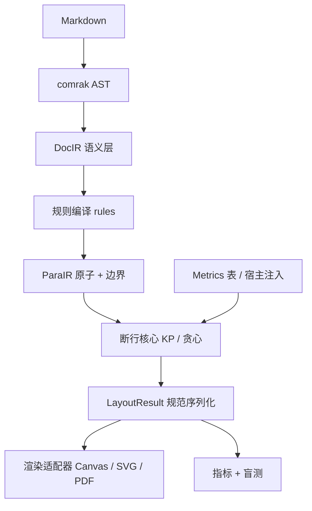

> **ARCHIVED 2026-11-20 — LEGACY, NOT NORMATIVE.** Superseded by `docs/architecture-v2.md` and `docs/adr/`. This document references a deleted prior project and must not be used as clean-room design input.

# 提案：中文优先排版核心的 Phase 1 落地方案

**对应 PRD：** [`prd.md`](prd.md)（终稿，2026-11-19）
**参考实现：** [`somadoc-engine`](somadoc-engine/README.md)（v0.1.0 + wasm 支持，commit `32424f1`）
**结论：** 把 `somadoc-engine` 定位为「前期研究 + 产品线」，新开一个干净的排版核心仓库/工作区来实现 PRD。不要试图在现有 Typst 管线里替换断行器：那里没有可注入的缝（seam）。

---

## 0. 摘要（先看这 10 条）

1. **PRD 的核心不是「再写一个 Knuth-Plass」，而是「把中文规则编译成可调代价模型，并能证明它更好」。** 评估框架应先于核心实现。
2. **现有工程的最大价值是前端、IR 形状、WASM/字体注入和预览经验，不是排版决策。** `build_typst_source` 之后，断行、行内间距和分页都在 Typst 内部完成。
3. **建议新仓库 `soma-typeset`，Apache-2.0；`somadoc-engine` 保留。** 代码复用要带 provenance，不要用 path dependency 把 Typst 带进核心。
4. **从第一天用整数定点（1/4096 em），核心不出现 `f32`。** 这是 G4「逐位一致」最便宜的实现方式，也避免阶段 2 返工。
5. **IR 分两层：`DocIR`（语义）和 `ParaIR`（原子 + 边界）。** 断行单元是一等属性，但不塞进语义 AST。
6. **K-P 核心保持脚本无关：中文规则在 IR 构建时编译成边界属性（禁断、glue、stretch/shrink、penalty）。** 代价模型的「动态部分」（badness、挤压、末行）在核心里。
7. **标点挤压只在行首/行尾做，不要建模成全局 glue。** 否则会在行中间过度挤压；把行边裁剪放进 line cost，DP 仍然成立。
8. **贪心基线要两条：Greedy-F（最远可放，工业基线）和 Greedy-C（同代价模型、无前瞻）。** 盲测用 Greedy-F，消融用 Greedy-C。
9. **Demo 必须用「哑渲染器」消费 `LayoutResult`，不能让浏览器或 Typst 重新断行。** 否则并排对比无效。
10. **样本集扩到 20 段混排（10 调参 + 10 冻结盲测）。** 12 段同时调参和盲测，容易过拟合，统计功效也不够。

对外一句话：**一个与运行时无关、把中文与中英混排规则编译成可调代价模型、用全局优化断行、结果可逐位复核的排版核心。**

---

## 1. 对 PRD 的判断

### 1.1 值得保留的设计

- 范围收得干净：只走 `MD → AST → IR → 段落级断行 → 序列化 → WASM demo` 一条路径。
- 评估先行，且承认「质量难以客观验证」是最大风险。
- 门禁式推进，不把阶段 2–4 包装成已承诺能力。
- 把中英混排提升为一等公民，纯中文/纯英文作为特例，这个抽象方向是对的。
- 一致性口径克制：「相同度量输入下结果相同」，而不是承诺像素级跨端一致。

### 1.2 需要先修正的 10 个点

| # | PRD 位置 | 问题 | 建议 |
|---|---|---|---|
| 1 | §5 阶段 2 / §6 F8 | F8 是 P0，但阶段 2 才列「排版结果序列化」 | 阶段 1 交付 canonical 序列化 v0；阶段 2 做规范冻结 + 跨运行时报告 |
| 2 | §7 `Metrics` 草案 | `advance(char, f32)` 按字符、用浮点，无法覆盖拉丁词/连字/字距，且破坏确定性 | 改为按原子/词取宽，`Width(i32)` 1/4096 em；行高用 ascent/descent；标点语义仍在 IR |
| 3 | §6 F5 | 「贪心基线」未定义，无法保证对比公平 | 定义 Greedy-F 与 Greedy-C；盲测用 F，消融用 C；`K-P ≤ Greedy-C` 是硬不变量，`K-P ≤ Greedy-F` 不是 |
| 4 | §8 指标 | 「标点挤压次数越少越好」与中文排版现实冲突；行宽方差口径含糊 | 改为「非必要挤压次数 + 挤压总量/分布」；行宽方差排除末行；违规从 `LayoutResult` 计算 |
| 5 | §8 样本/盲测 | 约 12 段混排同时调参与盲测；60% 胜率口径不明确 | 20 段混排，10 调参 + 10 冻结；定义段落胜出=多数评审，报告逐段票数与置信区间 |
| 6 | §9 一致性 | 浮点问题留到「必要时再评估」 | 第一天整数化；阶段 1 加 native vs `wasm32-wasip1` 哈希测试；阶段 2 出完整报告 |
| 7 | §10 第一周 | 要求 IR 断行单元抽象定稿 | 只冻结不变量（原子/边界/单位/版本），schema 允许增量；否则第一周会被假信息锁死 |
| 8 | §4 clean room | 同时要求「读源码确认」与「避开代码来源」 | 竞品核实先用文档 + 黑盒；核心冻结前不读 Typst 断行源码；阅读记录进 Notes |
| 9 | §7 核心资产 | 优化窗口调度器列为核心资产 | MVP 只做 Paragraph；API 留 `Window` 参数，非段落返回 `Unsupported`；调度器阶段 3 |
| 10 | §2 G4 | 「逐位一致」未区分布局结果与像素 | 明确承诺序列化 `LayoutResult`；字体光栅化/平台渲染不在承诺内 |

---

## 2. 与 `somadoc-engine` 的关系

### 2.1 为什么不能直接改现有工程

现有管线是：

```text
Markdown → build_typst_source → Typst source → typst::compile → PDF / SVG
```

证据：

- `crates/somadoc-engine/src/typst.rs:269` 的 `build_typst_source` 把 Markdown 转成 Typst 源码；`:294` 调用 `mdxport::convert_markdown_to_typst`；默认路径 `:227` 直接走 `mdxport::markdown_to_pdf`。
- 断行、齐行、CJK 间距、避头尾、分页都在 Typst 编译器内部完成。`TypstEngine` 没有暴露「注入自定义断行器」的接口。
- 现有 `RenderEngine` 契约是「文档 → PDF/SVG 字节」，不是 PRD 需要的「段落 IR + 度量 → 行结果」。这是一个不同的 seam（接口所在的位置）。
- 依赖树 `typst` / `typst-pdf` / `typst-svg` / `typst-assets` / `mdxport` 与 WASM 体积预算、clean-room 约束都不兼容。
- `crates/somadoc-core/src/ir.rs` 是 Pandoc 风格语义 AST：没有原子、边界、断行单元、标点类别、挤压许可、度量输入。它可以作为 `DocIR` 的祖先，不能直接当 `ParaIR`。

**结论：** 如果目标是验证 PRD 的核心假设，必须让渲染层消费我们输出的 `LayoutResult`，而不是让 Typst 重新排版。这是一次渲染层重写，不建议在阶段 1 做。

### 2.2 可复用资产

| 资产 | 位置 | 怎么用 | 注意 |
|---|---|---|---|
| 语义 IR 形状与 serde 约定 | `crates/somadoc-core/src/ir.rs` | 作为 `DocIR` 起点：块/行内节点、JSON 命名、独立构造 | 需补 style、source span、语言提示；不要直接复用为 `ParaIR` |
| Markdown / frontmatter 处理经验 | `crates/somadoc-engine/src/common.rs`、`mdxport` | 了解 frontmatter、变量合并、CJK 文本处理 | 建议新核心直接用 `comrak` AST，不要经过 Markdown→Typst |
| WASM 适配经验 | commit `513064a` | 目标条件依赖、内存模板、宿主注入字体 | 新核心不需要 tokio；字体度量改为 `Metrics` 注入 |
| 字体存储/注入 | `crates/somadoc-engine/src/svg_out.rs` | 「WASM 无系统字体，必须宿主提供」的接口经验 | 新核心用离线度量表 + `Metrics` trait，不引入字体解析 |
| 预览/会话/锚点 | `crates/somadoc-engine/src/svg_out.rs` | 源映射、增量预览、页面锚点的产品经验 | 阶段 1 只做 `LayoutResult`；增量重排阶段 4 |
| CI / release / 文档 | 仓库根目录 | fmt、clippy、test、docs、dependabot | 新仓库可复制并加 wasm size / eval baseline job |
| 样本素材与 CJK 字体经验 | 仓库与 `SOMADOC_FONTS_DIR` | 样本选材、字体许可、字体目录白名单 | 样本版权单独处理；参考排版不进公开仓库 |

### 2.3 明确不复用

- Typst 的断行、布局、模板系统与任何 Typst 源码/数据表。
- `RenderEngine` 的「文档 → 字节」契约。
- `somadoc-core::ir` 作为排版 IR。
- `mdxport` 的 Markdown→Typst 转换路径（可以借鉴其 frontmatter 经验）。
- `typst` 依赖树（体积与 clean-room 双重原因）。

### 2.4 Clean-room 边界与 provenance

建议新仓库根目录放 `PROVENANCE.md`：

- **自有代码复用：** 列出从 `somadoc-engine` 复用的文件、许可证、改动点。自有代码复用不违反 clean-room，但必须在文档里说清楚。
- **公开资料：** Knuth-Plass 论文、动态规划框架、`clreq`、GB/T 15834。实现从论文/规范文本出发，注明引用。
- **竞品核实：** 核心冻结前只做文档 + 黑盒对比；不要读 Typst 断行源码。若确需阅读，记录日期、文件、原因，并把实现笔记与阅读笔记隔离。
- **规则来源：** `rules/SOURCES.md` 给每条规则一个 ID，指向 `clreq` 条目或出版社实践；拿不准的规则作为参数，不硬编码。
- **第三方许可证：** 若复用 `comrak`（BSD-2-Clause）或 `mdxport`（MIT），在 `NOTICE` 中注明；字体建议用 Noto Serif CJK SC（OFL）；样本文本用 CC-BY-4.0 或 CC0。上线前逐项核实。

---

## 3. 技术方案

### 3.1 分层与 crate 结构



```text
soma-typeset/
  crates/
    soma-core/     # 单位、IR、断行、代价、结果；no_std + alloc
    soma-rules/    # clreq / GB 规则 → ParaIR 边界属性
    soma-md/       # comrak AST → DocIR
    soma-wasm/     # wasm-bindgen 薄封装
    soma-eval/     # 指标、哑渲染器、盲测生成器
  apps/demo/       # 静态网页 demo
  eval/            # samples / baselines / reports
  xtask/           # 度量表生成、fixture 生成
  docs/            # ADR、Notes、规则来源
```

依赖纪律：

- `soma-core` 不依赖 `typst*`、`font*`、`ttf-parser`、`comrak`、`wasm-bindgen`、`serde_json`。CI 用 `cargo tree -p soma-core` 做禁用依赖检查。
- `soma-core` 用 `#![no_std]` + `alloc`，把 G3「核心不依赖 DOM/文件系统/PDF/平台字体 API」变成编译期约束。
- `soma-rules` 只依赖 `soma-core` 的类型；`soma-md` 依赖 `soma-rules`；`soma-wasm` / `soma-eval` 在边缘。
- 如果必须与现有工程同仓库，至少拆成独立 workspace，避免 `cargo build --workspace` 把 Typst 带进来。

### 3.2 两级 IR：语义 IR 与排版 IR

| 层 | 内容 | 负责 | 不负责 |
|---|---|---|---|
| `DocIR` | 文档块、行内节点、样式、语言、source span | Markdown 前端 | 行宽、断行、度量 |
| `ParaIR` | 原子（atom）+ 边界（boundary）+ 段落样式 | 规则编译器 | 语法解析、渲染 |
| `LayoutResult` | 行、盒子、位移、挤压量、代价、版本 | 断行核心 | 像素、字体光栅化 |

`ParaIR` 草案：

```rust
pub struct Paragraph {
    pub style: ParagraphStyle, // width, indent, line_height, align
    pub atoms: Vec<Atom>,
    pub boundaries: Vec<Boundary>, // len = atoms.len() - 1
}

pub struct Atom {
    pub text: String,          // 或 source range
    pub kind: AtomKind,        // Cjk | LatinRun | DigitRun | InlineObject
    pub class: PunctClass,     // None / Open / Close / Middle / ...
    pub style: StyleId,
    pub compress_left: Width,  // 行边裁剪上限
    pub compress_right: Width,
}

pub struct Boundary {
    pub breakable: Breakability, // Allowed | Forbidden
    pub glue: Glue,              // width, stretch, shrink
    pub penalty: i32,            // 断点附加代价；禁断用 Forbidden 表达
}
```

示例：「中文 English，混排」→

| 元素 | 类型 | 说明 |
|---|---|---|
| `中` `文` | CJK atom | 每个汉字一个原子，可逐字断行 |
| `English` | LatinRun atom | 一个不可断词，内部不拆 |
| `，` | 点号 atom | 中文逗号，不可出现在行首 |
| `混` `排` | CJK atom | 可逐字断行 |

| 边界 | 断行 | glue | 说明 |
|---|---|---|---|
| 中 → 文 | Allowed | 0 + 小幅 stretch/shrink | 中文行内间距 |
| 文 → English | Allowed | 0.25em + stretch/shrink | 中英边界，断行时 glue 丢弃 |
| English → ， | **Forbidden** | 0 | 点号不可在行首 |
| ， → 混 | Allowed | 0 + 小幅 stretch/shrink | 逗号后可以断行 |

关键点：

- **断行单元是 `ParaIR` 的一等属性，不是 `DocIR` 的属性。** `DocIR` 不应该知道行宽和断行。
- **规则在 IR 构建时编译成数字/标志。** 核心不需要认识「中文逗号」，只需要知道某个边界禁断、某个边界可压缩、某个断点有 penalty。
- **`ParaIR` 可脱离解析器独立构造**，满足 F2；测试可以用手写 fixture。
- **glue 在断点处丢弃**，天然处理「中英边界不留下空格」和「英文空格不在行尾」；这是 box/glue/penalty 模型比「西文词 + 中文补丁」更干净的地方。

### 3.3 `Metrics`：整数定点 + 按原子取宽

PRD 草案建议改为：

```rust
pub type Em = i32; // 1/4096 em

pub struct Width(pub i32);

pub trait Metrics {
    /// 一个原子（CJK 字、拉丁词、行内对象）在给定样式下的宽度。
    fn advance(&self, text: &str, style: StyleId) -> Width;

    /// 行高所需的 ascent / descent / leading。
    fn line_metrics(&self, style: StyleId) -> LineMetrics;

    /// 可选；MVP 返回 0，后续可接 kerning。
    fn kerning(&self, _left: &str, _right: &str, _style: StyleId) -> Width {
        Width(0)
    }
}
```

设计理由：

- **按原子/词取宽，而不是按 `char`。** 拉丁词、数字串、行内代码是不可断单元；按字符取宽会把「词」和「字」混在一起。
- **整数定点。** 所有宽度用 1/4096 em 的 `i32`，代价用 `i64`；核心不做浮点除法。这样 native 与 wasm 的布局结果可以逐字节一致，不依赖平台的浮点行为。
- **标点类别不进 `Metrics`。** `Metrics` 只回答几何；标点语义、禁断、挤压许可在 `ParaIR`/规则层。
- **`Metrics` 是一个小接口、深实现。** 宿主可以用离线表、字体解析器、测试假表实现；核心只依赖这一个 seam。至少准备两套实现（离线表 A、合成表 B），让这个 seam 成为真实的 seam。
- **度量表离线生成。** 用 `xtask` 从字体文件生成：汉字/全宽字符用区间压缩（绝大多数汉字 = 1em），标点/比例字做例外表，拉丁字符按码位，kerning 可选。核心不引入 `ttf-parser`。
- **两套表跑同一用例。** 表 A 用 Noto Serif CJK SC + Source Serif 4 生成；表 B 全部 1em/0.5em 合成，用于验证核心不依赖具体字体。
- **样式与字号。** `StyleId` 覆盖 regular / bold / italic / code / 不同字号；宽度仍由 `Metrics::advance` 提供，行高/基线由 `GlyphMetrics` 提供。样式切换不产生断点；真正的首字下沉（多行 initial）不在 MVP。详见 [`soma-typeset/docs/kp-model.md`](soma-typeset/docs/kp-model.md) §2.9 / §3.10。

### 3.4 断行核心

#### 算法形态

`ParaIR` 转为 Knuth-Plass 的 box/glue/penalty 序列：

- 每个 atom → 一个 box（宽度来自 `Metrics`）。
- 每个 boundary → glue（可伸缩量来自 IR）+ penalty（断点代价）。
- `Forbidden` → 不可选断点；但保留 fallback 策略，不能无解崩溃。

DP：

```text
best[j] = min over i ( best[i] + line_cost(i, j) + break_penalty(j) )
```

- `line_cost(i, j)` 只依赖行起点和终点，因此可以用前缀和 O(1) 计算自然宽度、可伸缩量、挤压量。
- 行边标点裁剪只在 `line_cost` 里处理：断点落在标点旁时，允许裁剪该原子的外侧边距；不要把它建模成全局 glue，否则行中间会被过度挤压。
- 末行不齐行，单独加「末行过短」惩罚（对应「孤字成行」）。
- 容差/紧急伸展：先正常求最优；无可行解时放宽 tolerance；仍无解则允许禁断并记录 violation；最后才 overfull warning。**任何输入都不 panic。**
- 确定性 tie-break：`(cost, line_count, break_positions)` 字典序，写进文档并用测试锁定。
- 跨行节奏（相邻行 fitness）作为 P1 开关，不进入 MVP 的 DP 状态；先用评估数据判断是否值得。
- 实现顺序：先做 O(n²) 的参考实现（带前缀和），用暴力枚举验证最优性；性能不够再上 active list / 剪枝。

#### 两条贪心基线

| 基线 | 规则 | 用途 |
|---|---|---|
| **Greedy-F** | 取当前行能放下的最远断点；放不下则强制断 | 工业基线，盲测的「对手」 |
| **Greedy-C** | 在候选断点里选当前行代价最小者，无前瞻 | 同代价模型消融，验证「全局优化」本身的价值 |

F5 的「同一代价模型」需要拆开说：Greedy-C 和 K-P 共用同一 `line_cost`，所以 `K-P ≤ Greedy-C` 是硬不变量；Greedy-F 只是行为基线，不保证代价最优。把这两条都跑，报告才能回答「提升来自代价模型还是来自前瞻」。

### 3.5 代价模型 v1

把代价模型拆成两半，避免核心变成中文规则大杂烩：

| 部分 | 位置 | 内容 |
|---|---|---|
| 静态部分 | 规则编译器 → `ParaIR` | 禁断、断点 penalty、glue 宽度/伸缩、行边裁剪上限、中英边界理想间距 |
| 动态部分 | 断行核心 | badness、挤压代价、边界偏差、末行过短、断点 penalty 求和、紧急伸展 |

v1 的项：

| 项 | 含义 | 建议默认 |
|---|---|---|
| `badness` | 行伸缩比例偏离 0 的程度 | `100 × abs(ratio)^3` 的整数近似 |
| `compress` | 行边标点压缩量 | 每 1/4096 em 计费 + 每个标点固定费 |
| `boundary_dev` | 中英边界实际间距与理想值的偏差 | 平方惩罚；理想值 0.25em，待按 clreq 核实 |
| `short_last` | 末行过短 | 末行 < 2em 时大惩罚 |
| `emergency` | 紧急伸展/放宽 tolerance | 每行固定大惩罚 |
| `break_penalty` | 规则层给的断点代价（如标点堆叠） | 由规则表决定，核心只求和 |

- 权重控制在 6–8 个，全部整数，`CostConfig` 版本化。
- 默认值不写死在算法里：结构常量 / 规则比例 / 代价权重 / 样式度量 / 段落几何 / 评估协议分层，默认值作为 `default-v1` preset；详见 [`soma-typeset/docs/params.md`](soma-typeset/docs/params.md)。
- 标定方法：先手工给一组默认值，再在**调参集**上做小范围坐标下降/网格搜索；盲测集绝不参与调参。报告权重敏感性，不追求单点最优。
- 不做 per-sample 特判。任何「看到某段就换规则」的实现都应被评审拒绝。

### 3.6 序列化与确定性

`LayoutResult` 建议：

```json
{
  "schema": "soma.layout/1",
  "units": "1/4096em",
  "rulesVersion": 3,
  "metricsVersion": 2,
  "configHash": "9f2c...",
  "totalCost": 123456,
  "lines": [
    {
      "start": 0,
      "end": 8,
      "naturalWidth": 32768,
      "adjustment": 384,
      "edgeTrim": 128,
      "boxes": [
        { "atom": 0, "x": 0, "advance": 4096 },
        { "atom": 1, "x": 4096, "advance": 4096 }
      ]
    }
  ]
}
```

原则：

- 全部整数；不出现浮点、`NaN`、平台相关的 `usize`。
- 字段顺序固定；不用 `HashMap` 序列化；需要映射时用 `BTreeMap` 或数组。
- 核心提供 `write_canonical_json`（或等价的确定性 writer），不只依赖宿主的 serde 配置。
- 结果带 `schema` / `rulesVersion` / `metricsVersion` / `configHash`，便于复现和回归。
- 一致性承诺限定为 `LayoutResult` 的字节；像素、字体 hinting、平台渲染不在承诺内。
- 阶段 1 加一个 `native vs wasm32-wasip1` 的哈希测试：同一 fixture 输出同一 JSON 哈希。这比等到阶段 2 再发现浮点问题便宜得多。

### 3.7 WASM 与 demo

- `soma-wasm` 只做薄封装：`layout_markdown(md, config) -> json`、`layout_ir(ir, config) -> json`。核心不依赖 `wasm-bindgen`。
- Markdown 前端做成 feature；lean build 可以只带 `ParaIR`，把解析放到宿主。
- 构建：`opt-level = "z"`、`lto`、`strip`、`wasm-opt -Oz`；CI 记录 gzip 体积。
- **第一周就用真实骨架测量**：`wasm-bindgen + comrak + serde_json + 核心占位 + 度量表`，不要用 Typst 的体积做代理，那会严重误导。
- 临时预算（待实测后回写，不作为承诺）：
  - core-only（无 Markdown 解析）gzip < 120 KB；
  - 完整 demo（含 comrak + JSON + glue）gzip < 350 KB；
  - 1,000 汉字段落 WASM 断行 < 10 ms；
  - 首次实例化 + 首段排版 < 100 ms（中端笔记本）。
- 超预算的收缩顺序：Markdown 前端移到宿主 → JSON ABI 换紧凑二进制 → 砍非段落级代码 → strip/调试符号。
- **Demo 渲染器必须是「哑」的：** 从 `LayoutResult` 逐原子画（Canvas 或 SVG），同一渲染器同时服务两种算法。不要用浏览器原生文本布局，也不要用 Typst 重新排版；否则看到的差异不是断行算法的差异。
- Demo 交互：并排 Greedy-F vs K-P；滑杆调行宽、tolerance、中英边界间距、标点挤压权重；高亮断点/禁断/挤压/违规；导出 `LayoutResult` JSON。差异化视图：行数、总代价、违规计数。

### 3.8 评估体系

#### 样本集

| 层 | 数量 | 用途 |
|---|---|---|
| 混排-调参 | 10 段 | 调权重、看消融 |
| 混排-盲测 | 10 段 | **冻结**，只用于最终盲测与门禁 |
| 纯中文 | 5 段 | 混排模型的特例回归 |
| 纯英文 | 3 段 | 不拆词、英文断行不劣化 |
| smoke | 3–5 段 | 公开 demo 与 CI 快检 |

样本目录：

```text
eval/samples/
  mixed-001.md
  mixed-001.yaml     # id, lang, tags, widthEm, fontSizePt, indentEm, ruleIds, split: calibration|test
  zh-001.md
  en-001.md
```

- 样本覆盖：标点密集、长句、引号/括号嵌套、短行/窄栏、长英文词、数字与单位、中英标点混用。
- 参考排版只放本地，不进公开仓库；公开仓库只放自建样本、指标脚本和基线数据。
- 样本冻结后再实现核心；避免「照着样本写规则」。

#### 指标

| 指标 | 口径 | 类型 |
|---|---|---|
| 避头尾违规数 | 行首/行末标点类别违规，按规则 ID 计数 | guard，目标 0 |
| 标点堆叠数 | 行边界连续标点，按规则计数 | guard |
| 英文词拆断数 | 拉丁词原子被拆到两行的次数 | guard，目标 0 |
| 非必要挤压次数 | 不挤压也能满足容差却发生挤压的次数 | target |
| 挤压总量/分布 | 每行挤压量的总和与分位数 | target |
| 字间距调整量方差 | 排除末行；行内调整量的离散度 | target |
| 中英边界间距方差 | 边界实际间距与理想值的离散度 | target |
| 孤字成行数 | 末行仅 1–2 个原子 | target |
| 总代价 | 同一代价模型下的 `totalCost` | 诊断，不作跨模型比较 |

- 所有违规和指标从 `LayoutResult` + 规则表计算，不从渲染后的像素反推。
- CI 保存基线 JSON；guard 指标回退直接失败，target 指标变化给出报告并要求人工确认。
- 消融矩阵：Greedy-F、Greedy-C、K-P、K-P 去掉挤压、K-P 去掉中英边界、K-P 去掉末行惩罚。报告要能回答「哪一项贡献了什么」。

#### 盲测

- 10 段冻结混排样本；3–5 名熟悉中文排版的评审；每段二选一，隐去算法来源。
- 段落胜出定义：多数评审选 K-P（3 人时 ≥2，5 人时 ≥3）。
- 通过线：段落胜率 ≥ 60%，且没有任何一段出现全体评审一致选 Greedy-F。
- 记录每段一句理由；理由用于回写权重，但**不回写到盲测段落本身**。
- 报告逐段票数、胜率、二项分布置信区间；10 段样本的统计功效有限，结论措辞要克制。
- 参照对比（浏览器 CSS、出版品质样张）只用于说明差距，不作为通过条件。

### 3.9 工程与测试

| 类别 | 做法 |
|---|---|
| 最优性 | 短段落暴力枚举所有断点，验证 DP 总代价等于最优 |
| 不变量 | `K-P ≤ Greedy-C`；无禁断（除非 fallback）；行宽在容差内；同输入同输出 |
| 黄金测试 | 手写 `ParaIR` + 固定度量表 → 期望 `LayoutResult` JSON |
| 属性测试 | 任意合法 IR：不 panic、行覆盖完整、原子顺序不变 |
| Fuzz | 任意 Unicode/空段落/超长词/零宽边界，不崩溃 |
| 跨目标 | native vs `wasm32-wasip1` 哈希一致 |
| 依赖守卫 | `cargo tree -p soma-core` 禁用 `typst*`/字体/平台 crate；`no_std` 编译 |
| 体积/性能 | CI 记录 wasm gzip、native/wasm 基准；超预算报警 |
| 文档 | 每个 ADR 记录一个决策；`docs/notes/` 记录实验与结论；`rules/SOURCES.md` 记录规则来源 |

---

## 4. Phase 1 执行计划（6 周，假设 1 人全职）

| 周 | 交付物 | 退出条件 |
|---|---|---|
| W0 | 仓库/workspace、ADR-0001（整数单位）、ADR-0002（两级 IR）、ADR-0003（规则 vs 核心）、样本计划、CI 骨架 | 决策落纸，依赖边界生效 |
| W1 | 度量表生成器 + 表 A/B；`ParaIR`/`LayoutResult` v0；Greedy-F；WASM 骨架体积/延迟实测；5 段混排 smoke；竞品核实笔记 | 拿到真实体积/延迟数字；IR 不变量冻结 |
| W2 | K-P DP（带前缀和）+ 暴力最优性测试；Greedy-C；canonical writer；跨目标哈希 fixture | `K-P ≤ Greedy-C`、字节一致通过 |
| W3 | 规则编译器（标点类别、禁断、中英边界、挤压许可）；违规检查器；代价模型 v1；20 段样本 v1 | 规则单测 + 样本指标表可一键跑 |
| W4 | 行边挤压、末行惩罚、tolerance/fallback；消融矩阵；权重初调；性能优化 | guard 指标达标；报告能解释各项贡献 |
| W5 | `soma-wasm` + 哑渲染器 demo + 盲测页面；native/wasm 基准；文档/Notes | demo 可用；盲测包就绪 |
| W6 | 盲测执行（3–5 人）、权重复核、回归、门禁报告、`v0.1.0-research` | 门 1 结论明确，不粉饰失败 |

**门 1 检查清单：**

- [ ] 避头尾违规、标点堆叠、英文拆断不高于 Greedy-F。
- [ ] 盲测胜率 ≥ 60%，且无「全体一致选贪心」的段落。
- [ ] WASM 体积与首次排版延迟有实测数字，且 demo 在主流浏览器可用。
- [ ] 公开仓库可一键复现评估与基准；Notes 记录设计与结论。
- [ ] clean-room/provenance 文档完整；规则来源可追溯。
- [ ] 至少一个失败模式被如实记录（例如某项指标未达标），而不是只报喜。

如果门 1 失败：先判断是「代价模型不行」还是「实现/样本不够」；不要自动进入阶段 2，也不要用调参掩盖。

---

## 5. 需要你拍板的决策

| 决策 | 建议 | 理由 |
|---|---|---|
| 仓库形态 | 新仓库 `soma-typeset`；`somadoc-engine` 保留为参考/产品线 | clean-room 叙事、依赖隔离、WASM 预算 |
| 语言 | Rust | WASM + native 同源；与你现有工程一致 |
| 宽度单位 | 整数 1/4096 em | 逐位一致、跨目标稳定、避免阶段 2 返工 |
| 度量来源 | 离线表：Noto Serif CJK SC + Source Serif 4；表 A/B | 核心不解析字体；宿主可替换；OFL |
| Markdown 前端 | 直接用 `comrak` AST；当前 MSRV 1.85 选 0.55，或升级到 1.0（需 Rust 1.89） | 拿到 AST 自行转 `DocIR`；不经过 Markdown→Typst |
| 贪心基线 | Greedy-F + Greedy-C | 工业对比 + 同模型消融 |
| 序列化 | canonical JSON v0；后续可换二进制 | 可读、可 diff、可复现 |
| 样本规模 | 20 段混排（10 调参 + 10 冻结） | 避免调参与盲测重叠 |
| 许可证 | 代码 Apache-2.0；样本 CC-BY-4.0；参考排版不入库 | 与现有工程一致，便于采用 |
| 工期 | 6 周全职；兼职按 10–12 周估 | 评估 + 核心 + demo + 盲测都要时间 |
| 项目目标 | 阶段 1 按「研究 artifact + 产品可选性」管理；门 1 决定是否继续 | 避免提前承诺产品化 |
| 中英边界默认值 | 0.25em 起步，按 clreq 条目核实后回写；可调 | PRD 开放问题；不要硬编码为事实 |
| 属性扩展语法 | 阶段 2 再定；MVP 用 frontmatter/固定字段 | 避免首版范围膨胀 |
| 优化窗口 | 只实现 Paragraph；其他返回 `Unsupported` | 调度器是阶段 3 |

---

## 6. 风险与对策（相对 PRD 的增量）

| 风险 | 影响 | 对策 |
|---|---|---|
| 过拟合 20 段样本 | 盲测看似通过，实际不泛化 | 10 段冻结；不做 per-sample 特判；消融 + 敏感度报告 |
| 行边挤压模型破坏 DP 最优性 | 实现复杂、结果不稳 | 挤压只进 `line_cost(i,j)`；前缀和 O(1)；暴力枚举校验 |
| 哑渲染器不够「出版级」 | 盲测评审被渲染质量干扰 | 两种算法用同一渲染器；先做视觉 sanity check；渲染质量只影响观感，不影响断行差异 |
| 字体度量与渲染字体不一致 | 视觉位置与度量表不符 | demo 用同一字体源生成度量表；每个原子按 `LayoutResult` 定位，不让浏览器重排 |
| WASM 体积/延迟超预期 | 浏览器场景不可用 | W1 真实骨架实测；按既定顺序收缩；不拿 Typst 体积做代理 |
| Unicode/分词版本漂移 | 同输入跨版本结果变化 | 固定分词实现/依赖版本；结果里记录版本；fixture 锁哈希 |
| clean-room 被质疑 | 原创性受损 | 新仓库 + provenance；竞品先黑盒；阅读记录隔离 |
| 样本版权 | 不能公开 | 参考排版只本地；公开样本自建/CC；不提交扫描页 |
| 范围膨胀 | 首版交付不了 | MVP 清单写死；竖排/分页/增量/PDF 一律阶段 3+ |
| 盲测统计功效不足 | 60% 结论不稳 | 报告逐段票数与 CI；必要时扩到 20 段盲测；不夸大结论 |

---

## 附录 A：核心 API 草案

```rust
#![no_std]
extern crate alloc;

pub struct Width(pub i32);   // 1/4096 em
pub struct Cost(pub i64);

pub enum Breakability { Allowed, Forbidden }

pub struct Glue {
    pub width: Width,
    pub stretch: Width,
    pub shrink: Width,
}

pub struct ParagraphStyle {
    pub width: Width,
    pub first_indent: Width,
    pub line_height: Width,
    pub align: Align,
}

pub struct BreakConfig {
    pub tolerance: i32,          // 允许的伸缩比例上限
    pub emergency_stretch: Width,
    pub weights: CostWeights,
    pub window: Window,
}

pub enum Window {
    Paragraph,
    Page { height: Width },
    Chapter,
    Book,
}

pub enum BreakError {
    UnsupportedWindow(Window),
    EmptyParagraph,
    NoFeasibleBreak { line: u32 },
}

pub fn break_paragraph(
    para: &Paragraph,
    metrics: &dyn Metrics,
    config: &BreakConfig,
) -> Result<LayoutResult, BreakError>;

pub fn break_paragraph_greedy(
    para: &Paragraph,
    metrics: &dyn Metrics,
    config: &BreakConfig,
    mode: GreedyMode,
) -> Result<LayoutResult, BreakError>;
```

- `&dyn Metrics` 避免在 WASM 里为不同度量实现做单态化膨胀。
- `Window` 在 MVP 只接受 `Paragraph`，其余返回 `UnsupportedWindow`。
- `LayoutResult` 带 schema/version/hash；核心提供 canonical writer。

## 附录 B：第一周 TODO

- [ ] 建新 workspace 与 crate 骨架；加禁用依赖 CI。
- [ ] `ADR-0001` 整数单位；`ADR-0002` 两级 IR；`ADR-0003` 规则 vs 核心。
- [ ] 写 `Width`/`Cost`/`Atom`/`Boundary`/`Metrics`/`LayoutResult` 类型。
- [ ] 实现 Greedy-F + 一个朴素 K-P；用 5 个手写 `ParaIR` fixture 跑通。
- [ ] 度量表生成器：从 Noto Serif CJK SC + Source Serif 4 生成表 A；合成表 B。
- [ ] WASM 骨架：`wasm-bindgen + comrak + serde_json + 核心占位`，测 gzip 与首段延迟。
- [ ] 5 段混排 smoke + 违规检查器骨架（先做行首/行末标点两类）。
- [ ] 竞品核实笔记：Typst、LuaTeX+luatexja、CSS Text 4、阅读器；只写文档/黑盒结论。
- [ ] 写下「不做清单」：竖排、bidi、断词、分页、多栏、增量、PDF、整书。
- [ ] 门 0 复盘：体积/延迟是否可接受；IR 不变量是否需要调整。

---

## 附录 C：与 PRD 功能项的映射

| PRD | 落点 |
|---|---|
| F1 CommonMark AST + 标点语义 | `soma-md`（comrak AST → DocIR）+ `soma-rules` |
| F2 IR 与语法解耦 | `DocIR` / `ParaIR` 分层；手写 fixture 可独立构造 |
| F3 `Metrics` 接口 | `soma-core::Metrics` + 表 A/B；`no_std` + 依赖守卫 |
| F4 K-P 全局断行 | `soma-core::break_paragraph` + 暴力最优性测试 |
| F5 贪心基线 | `Greedy-F` / `Greedy-C` |
| F6 中文代价模型 | `soma-rules` 静态属性 + `soma-core` 动态代价 |
| F17 断行单元抽象 | `AtomKind` + `Boundary` |
| F18 中英边界 | 规则层 glue + 动态 `boundary_dev` |
| F19 混排标点优先级 | 规则层 `PunctClass` + `penalty` |
| F8 确定性序列化 | canonical `LayoutResult` + 跨目标哈希 |
| F9 质量评估 | `soma-eval` + 样本/基线 |
| F10 WASM demo | `soma-wasm` + `apps/demo` + 哑渲染器 |
| F11 性能/内存基准 | CI + benchmark + WASM 体积 job |
| F7 窗口参数 | `Window` 枚举；MVP 只支持 Paragraph |
| F12 跨运行时一致性 | 阶段 1 最小哈希测试；阶段 2 完整报告 |
| F13–F16 | 阶段 2/3/4，不在 MVP |
