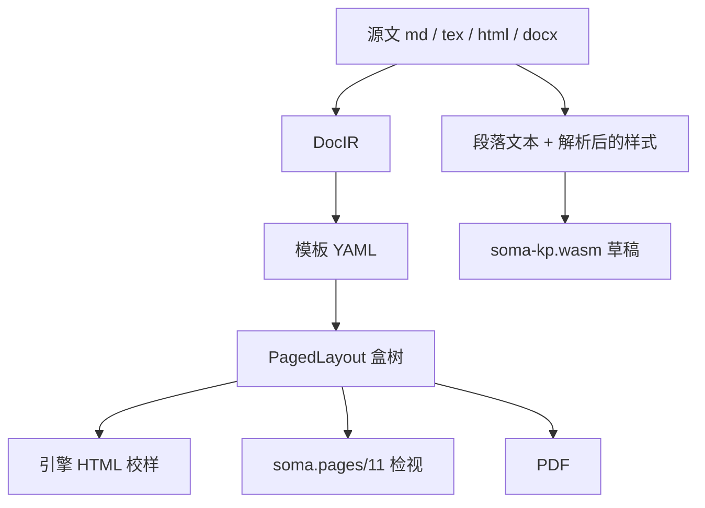

# 提案：Soma Studio —— 浏览器里的排版工作台

- **状态**：已实现（2026-11-25）；**技术栈修订**（见 §0.1），以 ADR-0093 为准。S1–S10 已落地；Worker 卸载与单文件导出未做，分别记入 D104/D105，见 [`docs/studio.md`](studio.md)
- **日期**：2026-11-25
- **相关**：ADR-0071（web 切片）、ADR-0072（emergency 候选窗口）、ADR-0044/0048（HTML 渲染器）、ADR-0009（语义/呈现边界）、`docs/architecture-v2.md`
- **触及**：新增 `soma-studio-core` / `soma-studio-ui` / `soma-studio`、`soma-render-html` 的 page fragment API、`docs/debt.md`、`docs/testing.md`、`README.md`；**不改 `soma-core` / `soma-layout` / `soma-rules` / canonical schema**
- **ADR**：ADR-0093

---

## 0. 一句话

**引擎整套编进 wasm：Leptos 前端在浏览器里解析、断行、分页、出页；Axum 只做文件、图片/字体、PDF 与 native 校验。两端同代码同度量，`PagedLayout::hash()` 必须相等。**

### 0.1 2026-11-25 技术栈修订（覆盖后文相应段落）

用户拍板：**Web 必须是全 Rust 的 wasm 前端 + Axum 后端**。因此本提案中以下内容被替代，细节以 ADR-0093 为准：

| 原提案 | 修订后 |
|---|---|
| vanilla JS / classic scripts / `web/studio/*.js` | **Leptos 0.8 CSR**（Rust → wasm），无 JS 壳 |
| 静态导出 + std-only `soma serve` | **Axum** 服务 `dist/`、API、PDF、SSE；`trunk build` 构建前端 |
| 三档确定性（浏览器 `measureText` / 引擎盒树 / JSON） | **同一引擎两端跑**：wasm 里直接链接 `soma-layout` + 内嵌 `.smt`；D95 的页面几何通过 native/wasm 哈希相等关闭 |
| `soma-kp.wasm` 作为 Studio 的 Live | Studio 不再加载 K-P 切片；切片保留给外部嵌入。Live 由同一个 wasm 引擎的段落路径提供 |
| 单文件只读导出 | 不作为 v1 交付；Axum 是唯一运行形态。静态导出可后续另立 ADR |
| 模式：源文/草稿/校样/检视/对比 | **源文/校样/检视/校验**；草稿并入源文，「对比」改为 wasm vs native 的哈希/页数校验 |

仍然有效的决定：标签页 = 文档、模式 = 视图；Proof 用引擎 HTML + Shadow DOM；38/30/29/24 与双主题；默认左右分栏（源文 + 校样，可关闭）；侧栏/AI 可缩放；AI 本地优先、只提议模板 diff、不下发断点；D101–D105 债务口径。

---

## 1. 要拍板的七件事

| # | 提案 | 备选 | 为什么 |
|---|---|---|---|
| 1 | **标签页 = 文档，模式 = 视图**（源文/草稿/校样/检视/对比） | 每个模式一个标签页 | 一个文档五种视图会立刻把标签条挤爆；模式属于文档当前状态，用 29px 面包屑行里的分段控件切换 |
| 2 | **Proof 直接注入引擎 HTML**（Shadow DOM），不在 JS 里重画盒树 | 在 JS 里按 `boxes` 逐 atom 画；或整个引擎编译进 wasm | 引擎 HTML 已经是 `PagedLayout` 的渲染结果；重画等于写第二个渲染器，必然漂移 |
| 3 | **Live 是段落放大镜，不是整页预览** | 在浏览器里做分页/脚注/表格 | 分页、脚注、表格、数学都在 `soma-layout`；搬进浏览器就是第二个引擎 |
| 4 | **静态导出优先；`soma serve` 是可选开发工具** | 先做服务器 | 静态导出可分享、可归档、可 `file://` 打开；服务器只解决「改了立刻看」 |
| 5 | **单文件导出只读（Proof + Inspect）** | 单文件里也带编辑器与 Live | `file://` 下 ES module / fetch / wasm 都有 CORS 限制；只读彻底绕开 |
| 6 | **关闭 D95 的「页面几何」部分**；Live 差异作为设计口径；新增字体一致性探针 | 现在就把 `.smt` 搬进 wasm 做 faithful | Proof 的断点/坐标与 PDF 同源；剩余差异是字形墨迹，不是排版 |
| 7 | **AI 本地规则优先；只提议模板 diff，绝不下发断点** | 让 AI 直接改布局 | N6 是非目标；AI 读 `layout.json` 解释事实，改模板要走 YAML 校验 + 重排 |

如果这七条通过，下面才是实现细节；任何一条改了，后面的数据流要重写。

---

## 2. 现状：不要重新发明

这些是代码事实，提案只在此基础上加一层壳。

| 已有 | 事实 |
|---|---|
| K-P 切片 | `web/soma-kp.wasm`：**32.7 KB gzip / 90,938 B raw / 0 imports**；W1–W6 门禁；1800 atoms 40 em 断行 7.2 ms，180 atoms 0.18 ms（`web/README.md`） |
| JS 客户端 | `web/soma-kp.js`（无依赖 ES module）、`soma-kp.worker.js`、`demo.html`、`harness.html`、`parity.txt` |
| 单文件演示 | `scripts/web-bundle.sh` 生成约 148 KB 的 `target/soma-kp-standalone.html`，`file://` 双击可用 |
| 整页 HTML | `soma-render-html::render_page_with` 可只渲染一页；输出绝对定位的 `.page/.block/.atom/.math`，内联 `<style>`，**不输出 `<script>`/`<a href>`**（ADR-0044/0048） |
| 整页 JSON | `soma render --format json` 输出 `soma.pages/11`：页、块、行（`ratioMilli`、`trimLeft/Right`、`boundaryDeviation`、`cjkLatinAdjustments`、`cost`、`boxes`、flags）、`outline` |
| 源文映射 | `Document::canonical_json()` 带节点 `span{source,start,end}`；`PagedLayout.text.blocks()` 给出每个 `NodeId` 的 atom 文本；`PlacedBlock.node` 把两边接起来 |
| 缺口 | 没有工作台；没有页级预览；没有行级检视；D95 口径含糊；没有字体一致性信号；没有源文↔布局的点击映射 |
| 纪律 | 918 个测试、12 项 Gate、语料基线 `ALL,48,599,1213,0,0,3,0,0,6,809,1404,428,9`；任何行为变化先写 ADR |

**本提案不碰的**：K-P DP、代价模型、trim、forced segment、fallback ladder、`soma-web` ABI、`soma.pages/11` 字段。

---

## 3. 产品定义

### 3.1 三个用户任务

| 角色 | 任务 | 主视图 |
|---|---|---|
| 作者 | 写内容，立刻看到这一段排出来 | 源文 + 草稿 |
| 排版工程师 | 看整页、看脚注、看表格、看数学 | 校样 |
| 审校/评审 | 定位「为什么这一行难看」 | 检视 + 对比 |

### 3.2 一条主线



**壳里没有第二套排版规则。** 壳只做三件事：加载产物、画覆盖层、把数字讲给人听。

### 3.3 三种确定性等级

- **Live**：只保证「引擎说这一行放得下，浏览器也放得下」。字体、字号、栏宽都来自当前浏览器；换浏览器就可能换断点，所以它永远带「草稿」徽标。
- **Proof**：`pages/<n>.html` 是 `PagedLayout` 的渲染，坐标是引擎的 `1/4096 em`；PDF 也吃同一棵 `PagedLayout`。因此**页码、断点、行盒坐标逐项相同**。字体缺失只影响字形墨迹，不影响断点，因为每个 atom 都是绝对定位。
- **Inspect**：只读 `soma.pages/11`。导出什么就显示什么；导出不了的字段写「—」，不写 0，也不在 JS 里假装算得出来。

---

## 4. 信息架构与 Shell

### 4.1 骨架

```text
┌──────────────────────────────────────────────────────────────────────────────┐
│ titlebar 38  ◧  Soma Studio · book.tex      ⌘K 搜索命令      ● 引擎就绪  ☀  ✦ │
├──────────────┬───────────────────────────────────────────────┬───────────────┤
│ sidebar 216  │ tabs 34  [book.tex ×] [模板:plex ×] [+]         │ AI header 34  │
│ header 34    ├───────────────────────────────────────────────┤ ● 排版助手 ▾ ×│
│              │ breadcrumb 29  book.tex / 校样 / 第 6 页  [模式] │               │
│ 稿件          ├───────────────────────────────────────────────┤ AI stream     │
│  book.tex    │ content                                       │               │
│  chapter2.md │  ┌────────────────┬────────────────────────┐  │               │
│ 大纲          │  │ 源文 / 行表      │ 校样画布（纸）           │  │               │
│ 视图          │  │                │                        │  │               │
│ 模板          │  └────────────────┴────────────────────────┘  │ composer      │
│ 诊断          │                                               │               │
├──────────────┴───────────────────────────────────────────────┴───────────────┤
│ statusbar 24  soma 0.1.0 · p:3f9a1c · 810 行 · 30 页 · 8.4 ms · 校样 · 100%   │
└──────────────────────────────────────────────────────────────────────────────┘
```

- **一条导航树**：只有左侧栏，不做 activity rail。
- **标签页是工作区**：打开、切换、关闭、空工作区；同一文档不重复开；关掉最后一个标签显示空状态，不强行打开仪表盘。
- **模式不是标签页**：面包屑行右侧的分段控件（源文/草稿/校样/检视/对比），窄屏退化为 `<select>`。
- **侧栏可拖拽/折叠**：216/240 默认，180–380 夹取；双击复位；持久化。
- **AI 是一块面板**：420/520 默认，320–60vw；只保留一行 30px 头（点 + 标题 + 模型 + 关闭）。
- **状态栏横跨全窗**：在 `.body` 之外，不被 AI 栏截断。

### 4.2 左侧导航（唯一）

| 组 | 内容 | 说明 |
|---|---|---|
| 稿件 | 源文件树（md/tex/html/docx） | 点击开标签；DOCX 只读 |
| 大纲 | `layout.outline` 的层级 + 页码 | 点击跳到页；页码用 `printed` 不是物理页号 |
| 视图 | 源文 / 草稿 / 校样 / 检视 / 对比 | 作用于当前文档标签 |
| 模板 | 当前模板 YAML、引擎配置（只读）、字体表 | 模板可编辑；引擎配置改了就换 `paramHash`，必须只读并提示 |
| 诊断 | 能力矩阵、债务表、门禁、字体一致性 | 作为内部页面标签打开 |

底部：引擎版本 + 主题切换入口 + 快捷键。

### 4.3 命令面板

640px 面板、44px 输入、34px 行、`↑/↓` 环绕、`Enter` 执行、`Esc` 关闭、点击遮罩关闭；打开时聚焦输入并全选，关闭后焦点回到原处。

动作清单（只有一份注册表，导航与面板共用）：

- 文件：打开文件…、打开模板…、重新排版、导出 PDF
- 导航：跳转到页…、跳转到大纲项…
- 视图：源文、草稿、校样、检视、对比、适应宽度、100%、150%
- 面板：折叠侧栏、显示/隐藏 AI、切换主题
- 诊断：复制 `paramHash`、打开引擎参数、打开能力矩阵、打开债务表
- 帮助：快捷键

**不做**：面板里放破坏性操作（删除源文件）而不确认。

### 4.4 键盘

| 快捷键 | 动作 |
|---|---|
| `⌘/Ctrl+K` | 命令面板 |
| `⌘/Ctrl+J` | AI 面板 |
| `⌘/Ctrl+Enter` | 重新排版（仅 serve 模式） |
| `⌘/Ctrl+S` | 保存（serve 模式写盘；静态模式下载） |
| `⌘/Ctrl+1…5` | 源文/草稿/校样/检视/对比 |
| `⌘/Ctrl+加/减/0` | 缩放 / 适应宽度 |
| `PageUp/PageDown` | 画布聚焦时翻页 |
| `Esc` | 关闭面板/覆盖层 |

不绑定 `⌘/Ctrl+W`（浏览器保留）。输入框内不拦截全局快捷键，但 `⌘K`、`⌘J` 例外。

---

## 5. 视觉规格

### 5.1 基线

| 元素 | 1080p | ≥2560 | 夹取 |
|---|---|---|---|
| 标题栏 | 38 | 40 | 固定 |
| 侧栏头 / 标签条 / AI 头 | 34 | 34 | 固定 |
| 面包屑 | 29 | 29 | 固定 |
| 状态栏 | 24 | 24 | 固定 |
| 侧栏 | 216 | 240 | 180–380 |
| AI 栏 | 420 | 520 | 320–60vw |
| 内容内边距 | 20/22/26 | 26/30/34 | — |
| 分隔条命中区 | 7 | 7 | — |

- 侧栏头、标签条、AI 头的底边在 1920×1080 必须落在同一 y。
- 活动标签 30px、非活动 29px，1px 重叠，顶部 1px accent 线。
- 状态栏在 `.app` 直接子级，横跨侧栏 + 主区 + AI 栏。

### 5.2 主题

- 直接采用 skill 的 `design-tokens.css` 深/浅两套；组件 CSS 只消费变量，不出现 hex。
- 初始化脚本在首屏前跑：`localStorage` → `prefers-color-scheme` → 深色；不闪错主题。
- **纸是唯一允许的纯白面**：`--paper: #ffffff` 在两套主题里都不变，因为它是印刷内容，不是 chrome。画布底色用 `--bg`，纸张加 `--page-shadow`。
- 新增语义 token：`--paper`、`--paper-edge`、`--page-shadow`、`--overlay-line`、`--trim-zone`、`--flag-emergency`、`--flag-overfull`。状态色仍用 `--green/--amber/--red/--purple`。
- 两套主题都要检查：页面画布、页阴影、检视覆盖层、行表 hover、输入框、焦点环、空状态、AI Markdown 表格。

### 5.3 字体与密度

- UI 无衬线：skill 的 `--sans` 栈（含 PingFang/Noto Sans SC）；等宽：`--mono`。
- 正文 13px/1.55；控件 11–12px；标签 9.5–10.5px/650–750；表格正文 11.5px。
- 所有哈希、页码、atom 下标、ratio、cost 用 `--mono` + `tabular-nums`。
- CJK 正文不加 `letter-spacing`；大写微标签只用于短拉丁组名。
- **页面里的字体只由模板决定**，UI token 不得泄漏进 Shadow DOM。

### 5.4 响应式

| 断点 | 行为 |
|---|---|
| ≥2560 | 标题栏 40；侧栏 240；AI 520；诊断页内容最大 1780px 居中；纸张可双页 |
| 1920 | 三栏；源文+校样默认 46/54 |
| ≤1500 | 检视卡片两列变一列；表格仍然不横向滚页 |
| ≤1280 | AI 变 420px 覆盖层；主区不被挤压 |
| ≤1180 | 源文/校样从并排改为单视图切换 |
| ≤980 | 隐藏侧栏与标题栏开关；导航走命令面板 |
| ≤760 | AI 全宽；**只读预览模式**（隐藏编辑器，保留校样/检视） |

**1366×768 不许出现页面级横向滚动。** 行表在 `.table-wrap` 内滚。

### 5.5 动效

- 主题/控件 120–150ms；AI 栏 180ms ease；拖拽时禁用过渡。
- 缩放用 `transform: scale()`，拖动时不动画，预设缩放 120ms。
- `prefers-reduced-motion: reduce` 下禁用过渡与脉冲；状态点改为静态文字。

### 5.6 Skill 对齐

| skill 规则 | 本提案的落法 |
|---|---|
| Chrome 安静、数据出声 | 壳是中性灰；纸是唯一高对比面 |
| 颜色全部语义化 | `design-tokens.css` 原样；组件零 hex |
| 38/30/29/24 对齐 | §5.1，写进 S1 门禁 |
| 一条导航树 | 只有侧栏；没有 rail |
| 标签页是工作区 | 文档标签 + 空状态 + 不重复 |
| 面板可缩放可关闭 | 侧栏、AI、源文/校样分隔条都满足 |
| AI 是一块面板 | 单行 30px 头；不堆状态条 |
| Markdown 渲染而非倾倒 | AI 回复走消毒后的 Markdown 渲染器 |
| 密度有节奏 | 13px 正文、8px 圆角、5/6/8/10/14 间距 |
| 图标按钮有 title/aria-label | S8 键盘/可访问性检查 |

---

## 6. 视图

### 6.1 源文（Source）

- `<textarea>` + 行号槽；不做富文本、不做多光标、不做 LSP。
- 4 空格制表；CJK 与 IME 组合期间不触发草稿重排（`compositionstart/end`）。
- v1 不做语法高亮；标题、列表、公式靠大纲和草稿反馈，不靠着色。
- DOCX 只读：显示「二进制源，只读」横幅，仍可校样/检视。
- 未保存状态：标签上一个 5px 点 + 状态栏文字；关闭前确认。
- 静态模式「保存」= 下载；serve 模式 = 写回项目根内的文件（路径白名单）。

### 6.2 草稿（Live）

- 只排**当前段落**：光标所在的 `NodeId` → `text.json` 的 atom 文本 → `soma-kp.js` 的 `compile`/`measure`/`break`。
- 样式从 `styles.json` 取：字体、字号、首行缩进、悬挂、行距、tracking、align；栏宽取 `layout.json` 里该块的 `width`。
- 宽度用 canvas `measureText`，量化到 `1/4096 em`；字体就绪前用 `document.fonts.ready` 等待，避免回退字体造成一次跳动。
- ≤800 atoms 主线程同步；>800 或 `fallback_stage != normal` 走 Worker；Worker 里再回退就换 `greedy`。
- 徽标永远显示：`草稿 · 浏览器度量 · 段级`。不显示页码，不画脚注，不声称与 PDF 一致。
- 失败状态：wasm 加载失败 → 「草稿不可用，校样不受影响」；不阻塞 Proof。

### 6.3 校样（Proof）

- 每页一个 `pages/<n>.html`（`render_page_with` 的输出），懒挂载：视口 ±1 页，其余占位。
- 页面注入 **Shadow DOM**：引擎的 `<style>` 只在影子根内生效，壳的 CSS 不会污染纸张；不需要 iframe，也不需要 `allow-same-origin`。
- 纸张尺寸来自 `layout.json` 的 `page.width/height`（1/4096 em）；页面 HTML 用 `em`，所以设置一个 `font-size` 就能整体缩放：
  - 100% 定义：物理页宽按 96dpi 换算的 CSS px（A4 210mm ≈ 793.7px）；
  - `pxPerEm = pageWidthPx / (page.width / 4096)`；
  - 缩放只改 `transform: scale()`，不改字号，避免重排所有 atom。
- 页与页之间 24px 间隔；纸张 1px `--paper-edge` + `--page-shadow`；画布底色 `--bg`。
- 分页导航：上一页/下一页、页码输入（接受 `printed` 与物理号）、大纲跳转、适应宽度。
- **覆盖层**：每个可见页一个绝对定位层，数据来自 `layout.json`：
  - 行盒（1px `--overlay-line`）、基线、版心线；
  - 裁剪区（`--trim-zone`）、行首/行尾 trim 方向箭头；
  - CjkLatin 边界刻度、`boundaryDeviation > 0` 的边界高亮；
  - overfull（`--flag-overfull`）、emergency（`--flag-emergency`）、forced end、hyphenated 标记；
  - 脚注区（紫色虚线框 + 规则线位置）。
  - 覆盖层接管指针事件；页面 HTML `pointer-events: none`。**Proof 里不选中文字**，源文才是可选择/可复制的表面。
- 空/错状态：缺页 → 页码占位 + 重试；缺 `layout.json` → 明确错误页，不白屏。

### 6.4 检视（Inspect）

画布显示覆盖层；右侧/下方是行表。

**行表列**（全部来自 `Line` 的 canonical 字段）：

| 列 | 字段 | 说明 |
|---|---|---|
| # | 行号 | 块内序号 |
| 原子 | `start–end` | `6–17` |
| 比例 | `ratioMilli` | `‰`，带正负条；> tolerance 红 |
| 调整 | `adjustment` | 1/4096 em，正=拉开，负=压缩 |
| 裁剪 | `trimLeft/trimRight` | 行首/行尾裁掉的宽度 |
| 边界偏差 | `boundaryDeviation` | 与 `cjkLatinAdjustments` 的逐项值并列 |
| 代价 | `cost` | 该行总代价 |
| 标记 | flags | overfull / emergency / forced / hyphenated |

- **导出不了的字段不造假**：`Line` 的 canonical 只有总 `cost`，没有逐项分解。v1 显示总代价 + 由 `ratioMilli` **精确重算**的 badness；`line/penalty/compress/boundary/short/height` 的分解标「—」，并在参数抽屉里说明「需要 trace 产物，见 D102」。
- **统计页签**：ratio 直方图、overfull/emergency 计数、trim 总量、fallback 分布、每页行数。直方图用 CSS/Canvas 画，不引图表库。
- **参数抽屉**：`paramHash`、`rulesVersion`、`metricsVersion`、`engineHash`、`tolerance`、`badness_scale`、各权重；只读，带「改这里会换模型版本」的提示。
- **点击映射**：
  - 覆盖层行 → 行表行 → 保留高亮；
  - 行 → 源文：通过 `block.node` 找到 DocIR 的 `span`，选中整个块；行级用 `text.json` 的前缀在块内做**最佳努力**定位，失败就选块。v1 明确写「块级精确，行级最佳努力」（D103）。
- **AI 入口**：选中行后，AI 面板的上下文芯片自动带上这一行的 ratio/trim/boundary/cost。

### 6.5 对比（Compare，W-P4）

- 同一段、同一栏宽：左 Live，右 Proof；下方列出断点差异（行尾 atom 下标）。
- 这是 D95 的**可视监控**：当字体一致时，差异应集中在 1–2% 的宽度误差；当字体缺失时，差异会放大，徽标同时提示。
- 不做跨文档 diff，不做版本历史。

---

## 7. 数据契约与两种后端

### 7.1 产物目录（静态导出）

```text
out/
  index.html                 # 壳（classic scripts，可 file:// 打开需单文件）
  assets/
    tokens.css
    studio.css
    studio/*.js
    soma-kp.wasm             # 目录模式通过 HTTP 加载
  doc/
    manifest.json            # soma.studio/1：元数据、能力、哈希、字体
    layout.json              # soma.pages/11，原样
    docir.json               # Document::canonical_json()，源文 span
    text.json                # NodeId -> atom 文本（TextIndex）
    styles.json              # StyleId -> 解析后的样式（Live 用）
    probe.json               # 字体一致性采样
    pages/1.html … N.html    # render_page_with 的输出
    doc.pdf                  # 可选（--pdf）
  source/
    book.tex                 # 原样拷贝，供源文视图/搜索
  templates/
    plex.yaml                # 可选拷贝
  fonts/                     # 可选（--embed-fonts；注意授权）
```

- `manifest.json` 的 `capabilities` 决定壳的行为：`edit`、`rebuild`、`exportPdf`、`live`、`ai`（`local`/`remote`/`off`）。
- `layout.json`、`docir.json`、`text.json`、`styles.json` 都是只读产物；壳不写回。
- `probe.json` 只用于诊断，不参与渲染。

### 7.2 单文件（`--single-file`）

- 只读：Proof + Inspect + 大纲 + 搜索 + 本地 AI 解释。
- wasm、CSS、JS、JSON、页面 HTML 全部内联；wasm 用 base64；页面 HTML 放进 `<template>`，由 JS 克隆进 Shadow DOM。
- `file://` 双击可用；不加载任何外部资源。
- 不提供编辑器、Live、重建、导出 PDF（按钮显示为「只读预览」并解释原因）。

### 7.3 开发服务器（`soma serve`，可选但推荐）

- 只用 std：`TcpListener` + 手写 HTTP/1.1 + SSE；**不加第三方依赖**。
- 绑定 `127.0.0.1`，启动时生成随机 token；页面通过 `<meta>` 注入，API 用 `?t=` 或 `X-Soma-Token` 校验；拒绝非同源 `Origin`。
- 端点：
  - `GET /` 壳；`GET /assets/*`
  - `GET /api/manifest` / `layout` / `docir` / `text` / `styles` / `probe`
  - `GET /api/page/<n>`
  - `GET /api/events`（SSE：`built`、`error`、`heartbeat`）
  - `POST /api/rebuild`
  - `POST /api/export?format=pdf`
  - `GET /api/tree` / `GET /api/source?path=…`
  - `POST /api/ai`（可选，服务端代理，key 只在服务端）
- 监听：每 250ms 轮询源文/模板/引擎配置/度量表的 mtime，200ms 去抖；重建成功发 `built`，失败发 `error` 并**保留上一版**。
- 路径安全：canonicalize 后必须在项目根内；拒绝 `..`、绝对路径、符号链接逃逸。
- 不做热模块替换、不做增量重排（N4 仍是非目标）。

### 7.4 为什么不用 npm / bundler / CDN

- 现有 web 切片就是零依赖、零构建；引入 React/Vite/Playwright 会把 32 KB 的切片变成一条工具链。
- 壳用 **classic scripts + IIFE 命名空间**，单文件时按固定顺序拼接即可；目录模式直接 `<script src>`。
- Live 的 `soma-kp.js` 是 ES module：目录/serve 模式用动态 `import()`；单文件只读模式不需要它。
- 门禁用 Chromium headless + 自检页 + `--dump-dom`，复用 `web/check.mjs` 的做法；不引入 Playwright。

---

## 8. CLI 变更

```text
soma preview --input <file> [--template <yaml>] [--engine <yaml>]
             [--metrics <smt>] [字体参数…]
             --out <dir> [--single-file] [--pdf] [--embed-fonts]

soma serve   --input <file> [--template <yaml>] [--engine <yaml>]
             [--metrics <smt>] [字体参数…]
             [--port 7070] [--open]
```

- `preview` 复用 `render_one` 的解析/模板/布局链，只布局一次，然后写多份产物；不重复跑 DP。
- 资产用 `include_str!` / `include_bytes!` 从 `web/studio/` 与 `web/soma-kp.wasm` 嵌入二进制；不依赖运行目录。
- `--single-file` 生成一个 HTML；体积预估：壳 + wasm + 30 页 HTML/JSON，约 3–8 MB（待 W-P1 实测）。
- `--pdf` 复用现有 PDF 后端，输出 `doc.pdf`，并在 `manifest` 里声明。
- 失败：打印带源文位置的诊断，非零退出；**不生成半成品清单**。
- `serve` 是开发工具，不进 `scripts/gates.sh` 的 12 项；只在 S9 门禁里跑。

**边界**：`preview`/`serve` 不改变 `render`/`check` 的任何输出与退出码。

---

## 9. AI 面板

### 9.1 形态（按 skill）

- 30px 单行头：6px 状态点 + 标题「排版助手」+ 模型选择（24px，168–220px）+ 关闭。
- 点颜色：绿=远端已配置；琥珀=本地规则；灰=关闭。`title`/`aria-label` 始终包含「提供方 · 模型 · 来源」。
- 模型选项：
  - `本地 · 规则`（默认，不联网）
  - `远端 · 经济`（未配置时禁用）
  - `远端 · 旗舰`（未配置时禁用）
- 本工具是**单用户本地工作台**，当前用户即管理员，所以模型选择可见；若未来接入多用户，普通用户只读模型标签。
- 空状态：品牌标记 + 一句话 + 快捷提示；建议芯片只在无消息时出现。
- 消息：助手 `--panel-2`、13px/1.7、最大 96%；用户 `--bubble-user`；代码/表格在面板内滚动。
- 输入：4 行 textarea，`Enter` 发送、`Shift+Enter` 换行、IME 组合中不发送；忙碌时禁用发送。
- Markdown：标题、粗体、列表、表格、代码、引用、链接；**消毒原始 HTML**；只允许 http(s) 链接；`target="_blank" rel="noopener noreferrer"`；不加载远程图片。
- 本地规则回复带「本地 · 规则」徽标；绝不冒充模型回复。

### 9.2 本地规则能做什么

读取选中行/页的 `layout.json` 事实，生成确定性的解释：

- 这一行为什么被压缩/拉伸（`ratioMilli`、`adjustment`、`trim`）；
- 为什么触发 emergency/fallback（`fallbackStage`、`emergency`、`overfull`）；
- 中英边界偏差 `boundaryDeviation` 与逐边界调整是否一致；
- 本页最差的三行（按 ratio 或 trim）；
- 模板层面的建议（只列模板 YAML 能表达的键，不列 `tolerance`/`badness_scale` 这类引擎旋钮）。

### 9.3 远端模型（可选）

- 只在 serve 模式可用；key 从服务端环境读，**浏览器永远拿不到 key**。
- 默认只发送当前页/当前行的布局摘要与用户问题，不发送整篇源文；发送前显示「将发送哪些字段」。
- **AI 永不下发断点/坐标**：它只能返回文字与模板 YAML 建议。壳里没有「AI → 断行器」的代码路径，S10 检查这一点。
- v1 的「应用」按钮只对**本地结构化建议**开放：显示 YAML diff，用户确认后写模板并触发重排；远端回复只读，需用户手动复制。

---

## 10. 确定性、D95 与字体一致性

### 10.1 D95 的收口

现在 `docs/debt.md` 的 D95 写的是「浏览器 preview 与 PDF 不同字节」。本提案把它拆成三件事：

| 项 | 结论 |
|---|---|
| **页面几何** | **关闭**。Proof 的 HTML 由 `PagedLayout` 渲染，PDF 也消费同一棵 `PagedLayout`；页码、断点、行盒坐标相同。不是「近似」，是同一份数据。 |
| **Live 断点** | **设计口径**，不是缺陷。Live 用浏览器度量、只做段级；UI 永远标「草稿」。 |
| **字形墨迹** | **保留为 D101**。浏览器用自己的字体成形；同字体文件下差异应 <0.5%，缺字体时由探针报警。 |

新增债务：

- **D101**：浏览器内没有 `.smt` 度量（faithful Live）；Proof 已覆盖页级保真，暂不做。
- **D102**：`Line` 的 canonical 只有总 `cost`，没有逐项分解；检视的代价瀑布需要 trace 产物，暂不做。
- **D103**：行内 atom 没有源文偏移；源文映射块级精确、行级最佳努力。

### 10.2 字体一致性探针

- `probe.json`：每个 face 采样 64 个字符串（CJK、拉丁、数字、标点、混排），附 `.smt` 的 advance（1/4096 em）。
- 浏览器用同一 CSS family 测 `measureText`，量化后比较；报告 `p50/p95/max` 相对误差与缺失字体。
- UI 徽标：
  - `字体一致`：p95 < 5‰；
  - `接近`：5–20‰；
  - `不一致`：>20‰ 或缺字体，tooltip 列出前 5 个偏差样本。
- 这不是硬失败：Proof 的断点仍然正确；它解释「为什么屏幕上字看起来略宽/略窄」。
- S9 门禁：装好基准字体时 p95 < 20‰；卸载字体时徽标必须变「不一致」且应用不崩。

### 10.3 确定性口径

- Proof 的页面 HTML 是只读产物；壳不改写、不重排、不注入会影响布局的 CSS。
- Live 的宽度量化规则与 `soma-kp.js` 现有规则一致（`round(px / sizePx * 4096)`）。
- `paramHash`、`rulesVersion`、`metricsVersion`、`engineHash` 原样显示；壳不计算、不缓存替代值。
- 单文件导出的页面 HTML 与目录导出的同名页**字节相同**（S5）。

---

## 11. 性能预算

| 场景 | 目标 | 依据/备注 |
|---|---|---|
| 首屏（目录模式，本地 HTTP） | < 1.5 s 到可读 | 壳 < 100 KB JS/CSS；首屏只挂第 1 页 |
| 首屏（单文件，30 页） | < 2.5 s | 内联 JSON/HTML 较大；只解析第 1 页 |
| 输入 → Live（≤800 atoms） | < 16 ms | 现有 1800 atoms 7.2 ms；800 是主线程阈值 |
| Live 回退 | < 2 ms | greedy 实测 ≤1.1 ms |
| 重建（serve，30 页） | < 1 s（临时预算，W-P1 实测后回写） | 不在本提案里承诺硬数字 |
| 内存（30 页挂载 + 覆盖层） | < 300 MB | 视口 ±1 页虚拟化 |
| 壳 gzip | < 60 KB（不含 wasm） | 无图表库、无 Markdown 大包 |
| wasm | 不变：32.7 KB gzip | 复用现有切片 |

- 大文档：懒挂载 + `IntersectionObserver`；页 HTML 解析一次，缓存 DOM 片段。
- 缩放：只改 `transform`，不重排文字。
- 拖拽分隔条：`requestAnimationFrame` 节流；拖拽期间禁用过渡。
- 任何超预算都先记录数字，再决定是否剪枝；不为了「看起来快」加 spinner。

---

## 12. 门禁与验收

### 12.1 新增 `scripts/studio.sh`（S1–S10）

不复用 `scripts/web.sh` 的 W1–W6，也不改它们；S 门禁独立跑。

| ID | 检查 | 判据 |
|---|---|---|
| S1 | Shell 基线 | 38/30/29/24；三条 30px 底边同 y；默认分栏；状态栏横跨全窗；只有一棵导航树 |
| S2 | 标签页 | 开 3 个文档 = 3 个标签；不重复；关活动标签选右邻；关完显示空工作区；`+` 打开面板 |
| S3 | 面板 | 侧栏 180–380、双击复位、持久化、折叠；AI 320–60vw、双击 420/520、≤1280 覆盖、关=0 宽 |
| S4 | 主题 | 首屏不闪；持久化；标题栏与面板都能切；组件无 hex；两套主题可读 |
| S5 | Proof 同盒树 | `manifest.pages == layout.pageCount == 页面槽数`；每页 `data-page` 连续；单文件与目录同名页字节相同；`--pdf` 页数相同 |
| S6 | Live | 防抖重建；IME 组合不重排；fallback→greedy（内核测试）；Worker 卸载延后（D104） |
| S7 | Inspect | 行表行数 = 当前页覆盖层行数；点行高亮；同名行盒；不可得字段显示「—」 |
| S8 | 离线/安全 | 无外部请求；页面 Shadow DOM 无 `script` / `a[href]`；AI HTML 被消毒；CSP 生效；单文件导出延后（D105） |
| S9 | 字体/重建 | 探针 p95 阈值与缺字体降级；serve 改文件后 SSE `built`；构建失败保留上一版并显示诊断 |
| S10 | AI 边界 | AI 输出没有任何路径进入断行器/渲染器；本地建议的 YAML diff 必须过模板校验；远端默认关闭 |

实现方式（已落地）：`crates/soma-studio-ui/src/selftest.rs` 在 Chromium headless 里跑断言，`scripts/studio.sh` 用 `--dump-dom` 抓 `S1|ok|…`；`docs/studio.md` 记录实际判据与脚本侧的 CSP/PDF/SSE 检查。

### 12.2 验收清单（人工）

**Shell**
- [ ] 标题栏 38px；侧栏头/标签条/AI 头 30px；面包屑 29px；状态栏 24px；默认左右分栏。
- [ ] 状态栏在侧栏、主区、AI 栏下方连通。
- [ ] 1366×768 无横向滚动。
- [ ] 只有一条导航树。

**主题**
- [ ] 首屏无错误主题闪烁；`prefers-color-scheme` 首次生效。
- [ ] 刷新后保留；标题栏与命令面板都能切。
- [ ] 两套主题下行表、覆盖层、AI 表格、空状态都可读。
- [ ] 纸始终是纸（白），画布跟随主题。

**标签页**
- [ ] 打开 3 个文档正好 3 个标签；重复打开不新增。
- [ ] 活动标签总有 ×；hover 任意标签出现 ×。
- [ ] 关非活动标签不换页；关活动标签选右邻，否则左邻。
- [ ] 全关显示空工作区；标签条与 `+` 仍在。
- [ ] 状态栏标签数与实际一致。

**面板**
- [ ] 侧栏拖拽平滑、夹取 180–380、双击 216/240、刷新保留。
- [ ] 折叠后主区扩展；标题栏/命令面板可恢复。
- [ ] AI 关闭时宽度为 0；拖拽 320–60vw；刷新保留。
- [ ] ≤1280 覆盖、≤760 全宽；≤980 隐藏侧栏。

**源文 / 草稿**
- [ ] 输入 CJK 不触发两次重排；IME 组合期间不重排。
- [ ] 光标换段时草稿切换段落；栏宽/样式来自 `styles.json`。
- [ ] >800 atoms 不卡主线程；回退徽标出现。
- [ ] 草稿永远标「段级 · 浏览器度量」，不出现页码。

**校样**
- [ ] 页数、页码、页宽高与 `layout.json` 一致。
- [ ] 缩放不换断点；适应宽度在 1366 下可用。
- [ ] 大纲点击跳到正确页；`printed` 页码显示正确。
- [ ] 缺页/缺产物显示可操作的错误，不白屏。
- [ ] 覆盖层可开关；行盒与文字对得上。

**检视**
- [ ] 行表列与 `Line` 字段一一对应；ratio 正负条正确。
- [ ] 点行→画布高亮→源文块选中；再点另一行不残留。
- [ ] 统计直方图与行表数字一致。
- [ ] 参数抽屉显示 `paramHash`/版本；只读。
- [ ] 不可得字段是「—」，不是 0。

**AI**
- [ ] 只有一行头；状态点有文字/tooltip。
- [ ] 本地规则回复有「本地 · 规则」徽标；远端未配置时不可选。
- [ ] Markdown 表格/代码/链接正确；原始 HTML 被转义；不安全 URL 不可点。
- [ ] Enter 发送、Shift+Enter 换行；IME 组合中不发送。
- [ ] 没有任何「AI 生成断点」的入口。

**可访问性 / 动效**
- [ ] 图标按钮有 `title` + `aria-label`。
- [ ] 焦点环两套主题可见；标签/导航/面板键盘可达。
- [ ] `prefers-reduced-motion` 关闭过渡。
- [ ] 状态不只靠颜色；正文对比度 ≥4.5:1。
- [ ] 提供「无障碍文本」视图（按 DocIR 阅读顺序），页面画布有 `aria-label`。

---

## 13. 里程碑

| 阶段 | 内容 | 门禁 | 估算 |
|---|---|---|---|
| **W-P0** | ADR-0093、D95 拆分、token 文件与 shell 骨架冻结 | 评审通过；不改代码行为 | 0.5–1 天 |
| **W-P1** | `soma preview --out` + 静态壳 + Proof + 标签/主题/面板/命令面板（AI 空壳） | S1–S5、S8 部分 | 3–4 天 |
| **W-P2** | 源文编辑器 + 草稿 Live + Worker + 字体探针 | S6、S2/S3 完整 | 3–4 天 |
| **W-P3** | 检视覆盖层 + 行表 + 统计 + 大纲跳转 + 搜索 | S7 | 3–5 天 |
| **W-P4** | `soma serve` + AI 本地解释器 + 对比视图 + 导出 PDF | S9、S10 | 4–6 天 |
| **W-P5**（可选） | faithful `.smt`、模板表单、缩略图、PNG 导出 | 另立 ADR | 按需 |

- 总计 W-P0–W-P4 约 **3–4 周全职**，不含真实语料盲测与截图返工。
- 每个阶段都可停：W-P1 结束就是一个可分享的只读校样；W-P3 结束就是一个可用的诊断台。
- 估算偏保守：本仓库首次建立 canonical/哈希门禁的阶段历史上都会超 50%，这次把 S5/S6 放在前面。

---

## 14. 风险与对策

| 风险 | 影响 | 对策 |
|---|---|---|
| 浏览器没有模板字体 | 字形宽度不同，用户以为断错了 | 探针徽标 + 字体缺失提示；Proof 断点不受影响；`--embed-fonts` 可选 |
| 30 页页面 HTML 太重 | 首屏慢、内存高 | 视口 ±1 页懒挂载；页 HTML 只解析一次；S9 测内存 |
| 单文件过大 | 分享不便 | 30 页约 3–8 MB；提供目录模式；单文件只读，不内联编辑器 |
| 源文↔行映射不准 | 点击选中错位 | v1 只承诺块级；行级最佳努力并显式标注；D103 |
| Live 与 Proof 断点不同 | 用户不信任 | 永远标「草稿」；对比视图量化差异；不把 Live 当交付 |
| AI 被当成排版器 | 违反 N6 | 无代码路径；S10 门禁；本地建议只改模板 YAML |
| 服务器安全 | 本地端口被网页滥用 | 只绑 127.0.0.1；token；Origin 校验；路径白名单 |
| 范围膨胀成 IDE | 工期失控 | 编辑器不做语法高亮/多光标/LSP；模板不做表单；不做协作 |

---

## 15. 非目标（写清楚，免得误用）

- **不做富文本编辑器**（N5）：源文是纯文本；不做所见即所得的光标排版。
- **不做 AI 生成断点/坐标**（N6）：AI 只解释和提议模板。
- **不做浏览器内分页/脚注/表格/数学布局**：这些在引擎；Live 只做段级。
- **不做增量重排**（N4）：一次编辑重排整篇；Live 只重排当前段。
- **不做 faithful `.smt`**（D101）：Proof 已覆盖页级保真。
- **不做模板设计器 GUI**：v1 是 YAML 查看/编辑 + 校验；表单另立提案。
- **不做协作、云同步、账号、权限**：本地优先。
- **不做移动端编辑**：≤760px 只读预览。
- **不做页面缩略图/PNG 导出/打印 CSS**：W-P5 可选。

---

## 16. 对已冻结架构的影响

| 项 | 影响 |
|---|---|
| `soma-core` / `soma-layout` / `soma-rules` | **零改动**；canonical schema 不变 |
| `soma-web` ABI | **零改动**；复用现有导出 |
| `soma-render-html` | 零改动；使用现有 `render_page_with` |
| `soma-doc` | 零改动；使用现有 `canonical_json()` 与 `TextIndex::blocks()` |
| `soma-cli` | 新增 `preview`/`serve` 子命令；`render`/`check` 不变 |
| 新资产 | `web/studio/`（壳、样式、视图模块、harness） |
| 文档 | `docs/proposal-web-preview.md`（本文）、`docs/studio.md`（实现后）、`docs/debt.md`（D95 拆分 + D101–D103）、`docs/cli.md`、`README.md` |
| 门禁 | 新增 `scripts/studio.sh`（S1–S10）；`scripts/gates.sh` 与 `scripts/web.sh` 不动 |
| ADR | **ADR-0093：Web Studio 的三档确定性**（记录 §1、§3、§7、§10） |

**不新增核心依赖，不引入 npm/bundler，不改语料基线。**

---

## 17. 需要拍板的问题

1. **标签页 = 文档，模式 = 视图**，同意吗？
2. **Proof 用引擎 HTML + Shadow DOM**，Live 只做段落放大镜，同意吗？
3. **静态导出优先，`soma serve` 作为可选开发工具**，同意吗？
4. **单文件只读（Proof + Inspect）**，编辑/Live 只在目录/服务模式，同意吗？
5. **D95 按 §10 收口**（页面几何关闭、Live 为设计口径、新增 D101–D103），同意吗？
6. **检视 v1 只显示导出字段，代价分解延后**（D102），同意吗？
7. **AI 本地优先、只提议模板 diff、永不下发断点**，同意吗？

拍板后：先写 ADR-0093 与 token/shell 骨架（W-P0），再按 W-P1 → W-P4 落地；每阶段结束跑 S 门禁与截图，不改现有 12 项 Gate 与语料基线。

---

## 18. 一句话总结

**引擎只产出一次，壳用三种方式读它：草稿读段、校样读页、检视读行；所有「为什么」都指向同一份 `soma.pages/11`，而不是第二套排版逻辑。**
