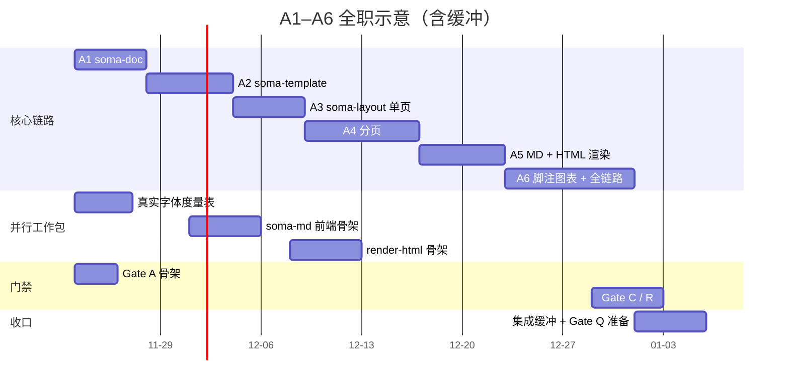

# 路线图 v2：A0–A6 排期

状态：**2026-11-20 提出，待拍板。** 架构已冻结（`docs/architecture-v2.md` +
ADR-0001…0009），K-P 内核已收口（`docs/kp-closure.md`：116 tests、Gate T 全绿）。
本文件只解决一件事：**按什么顺序、花多少时间、用什么门禁把架构变成代码。**

未做项见 `docs/debt.md`，本文引用其 ID（D01…D30、N1…N6）。

---

## 0. 基线

| 项 | 状态 |
|---|---|
| 行内 K-P | 冻结可用（ADR-0007）：代价模型、trim、forced segment、fallback ladder、atom 数窗口 |
| 确定性 | 整数定点、无浮点、canonical JSON `soma.layout/6`、native/wasm 同哈希（4,901 bytes） |
| 性能 | 4,000 atoms：pure-cjk 0.55 ms / mixed 0.55 ms / punct-dense 1.20 ms（P50，release） |
| 测试 | 116 tests；差分测试 6 个（暴力 vs DP ×3、剪枝 vs 暴力、K-P vs Greedy ×2） |
| 门禁 | Gate T pass；Gate Q `Inconclusive`；Gate D `Partial` |
| 缺的地基 | DocIR、模板、盒子树、分页、语法前端、正式渲染器（D20–D27） |

结论：**行内是资产，块级和文档级是空白。** 排期全部围绕补这两层。

## 1. 排期口径

1. **单位：人日**，1 名工程师 + AI 辅助，全职（5 d/周）；兼职按 `人日 ÷ 每周天数` 折算。
2. **估算是区间，不是承诺。** 每个里程碑结束重估下一个，不一次定死到 A6。
3. **两列估算：**「最小切片」= 能跑通、有 golden、有诊断的下限；「可交付」= 加上边界情况、错误路径、文档、门禁的完整形态。**排期按「可交付」算。**
4. **依赖严格串行**（架构 §18），并行只发生在写集不相交的工作包（§4）。
5. **冻结内核**：`soma-core` 只修 bug，不新增文档/模板/页面类型。新管线在 `soma-layout` 包一层（ADR-0007、§15.3）。
6. 每个里程碑出口 = 新测试全绿 + `scripts/gates.sh` 全绿 + 该层 Gate 通过 + 一页报告。

## 2. 里程碑

进度：**A1–A6 全部完成**（报告：`docs/a1-report.md`、`docs/a2-report.md`、`docs/a3-a6-report.md`）；ADR-0010 / ADR-0011 已采纳。
下面保留已完成项作为基线，其余为待执行。

| # | 里程碑 | 关键交付物 | 退出条件 | 依赖 | 最小切片 | 可交付 |
|---|---|---|---|---:|---:|---:|
| A1 ✅ | `soma-doc` | DocIR 节点集（§5.2）、`NodeId`、`SourceSpan`、`source_map`、canonical JSON、`docHash`；**删除** `soma-core::semantic`/`text` | Gate A1：canonical golden；未知节点不丢（`RawBlock`/`RawInline` fallback）；span 覆盖；`soma-core` 不再导出语义类型；现有 116 个测试全部保留（legacy 相关测试迁到 `soma-doc`） | A0 | 2 d | **4 d（已交付）** |
| A2 ✅ | `soma-template` | 纯 YAML manifest + rules 解析、精确单位换算、选择器级联（元素/role/class + 特异性 + 顺序）、属性白名单校验、`templateHash`；产出 **`StyledDoc`（纯数据 + `styleHash`，ADR-0010 §3）** | Gate A2：`10.5pt / 1.6 / 2em` 精确转 1/4096 em（无 f64 中间量）；非法属性报错带行列号；槽位校验；hash 稳定；`StyledDoc` 无生命周期 | A1 | 3 d | **4 d（已交付）** |
| A3 ✅ | `soma-layout`（单页） | `VBox`/`HBox`/`ParagraphBox`/`Glue`/`Penalty`；`ParagraphBox` → `soma-rules` → 行内 K-P；`MetricsProvider` seam + 真实字体度量表；`EngineConfig`（§9 YAML）；**按 ADR-0010：`PagedLayout` 每行带来源 `NodeId`、渲染 seam `TextSource`、不得深拷贝 `Document`** | Gate A3：盒子树 golden；**同一 `Paragraph` 经 `ParagraphBox` 与直接调 K-P 得到的断点序列、每行宽度/调整量完全一致**；宽/高/基线不变量；`engineHash` 存在；分配计数不随文档规模线性增长 | A2 | 3 d | 4–5 d |
| A4 ✅ | 分页 | 垂直 K-P + 无解回退确定性贪心；页面模板、页眉/页脚槽位、页码；widow/orphan；keep-with-next；`paginationVersion` + `pageModelHash` | Gate A4：页面覆盖完整（内容不丢不重）；孤行寡行规则；页脚高度参与页高；回退有 `breaker_used` 标记；确定性（同输入同字节） | A3 | 4 d | 6–8 d |
| A5 ✅ | `soma-md` + `soma-render-html` | comrak → DocIR（标题/段落/强调/链接/代码/列表/引用/硬换行/脚注引用）；能力矩阵；降级诊断；绝对坐标 HTML，不重排 | Gate C：能力矩阵覆盖、未知节点降级 + 诊断码；raw 安全（无脚本/网络）。Gate R：同一 `LayoutResult` 的坐标与 canonical JSON 一致；渲染器不改断点/行宽 | A4 | 3 d | 5–6 d |
| A6 ✅ | 脚注 / 图 / 表 / 公式 / 全链路哈希 | 整块脚注 + 每页重排收敛（上限 8）+ 编号；`ImageBox`；简单表；`MathLayout` 适配器；全管线 native/wasm 同哈希 | Gate A6：收敛上限可达且诊断清晰；脚注编号口径；脚注整块移页不跨页拆；全管线同哈希；性能不退化 | A5 | 5 d | 7–9 d |

**A1 已交付：实际 4 人日**（计划 4–5）。**A2 已交付：实际 4 人日**（计划 5–6）。

**A3–A6 已交付**（一次完成）。剩余工作见 `docs/debt.md`：无垂直 K-P、无段落跨页、
无页面母版、无 Math 适配器、Gate C/R 未建。

> 这只是 **A1–A6 核心链路**。Gate Q（D01）、标定（D04/D05）、Word/PDF（N1/N2）不在内。

## 3. 时间线（示意）

A1、A2 已交付；下图保留它们作为已完成基线，实际剩余从 A3 起算。
按 5 个工作日/周排；`d` 是工作日近似，周末未剔除。

关键路径：`A1 → A2 → A3 → A4 → A5 → A6`，无并行捷径。
`A4`（分页）和 `A6`（脚注收敛）是最大不确定项，若超支优先砍范围（§5）。

**想更早看到东西：** 只做最小切片的话 `A1→A5` 约 15 人日（3 周），能跑通
`Markdown → DocIR → 模板 → 盒子 → 单页 → HTML`，没有分页、没有脚注。

## 4. 并行工作包（写集不相交）

| 工作包 | 可开工时点 | 只写 | 产出 |
|---|---|---|---|
| WP-1 真实字体度量表 | 立即（不依赖 A1） | `crates/soma-metrics-table/`（新 crate）+ 一个 CJK 子集表 | `Metrics` 的真实实现；`MetricsProvider` seam 的另一侧（D06） |
| WP-2 Gate A 骨架 | ✅ 已完成（A1） | `scripts/gates.sh` + `scripts/gate-a.sh` | 层间依赖检查、schema 版本存在性、DocIR 纯净性（已完成） |
| WP-3 `soma-md` 骨架 | A1 绿后 | `crates/soma-md/` | 只依赖 `soma-doc` API 的 frontend trait 实现 + 能力矩阵表（D24） |
| WP-4 `soma-render-html` 骨架 | A3 绿后 | `crates/soma-render-html/` | 消费 `LayoutResult` 形态，不依赖分页完成（D25） |
| WP-5 Gate C / R | A5 期间 | `scripts/gate-c.sh`、`scripts/gate-r.sh` | 能力矩阵断言、坐标一致性比对 |

并行约束：WP-3/4 只能读 A1/A3 的公开 API，发现缺字段走 ADR，不反向修改冻结内核。

## 5. 范围闸门（超支时先砍什么）

按「砍了不影响架构正确性」排序，从前到后砍：

1. A6 的表和公式（降级为文本 + 诊断，接口保留）；
2. A6 的图（保留 `ImageBox` 类型，不做浮动）；
3. A4 的 keep-with-next（保留字段，先不生效）；
4. A4 的垂直 K-P（先用确定性贪心 + widow/orphan，接口不变）；
5. `soma-latex` / `soma-html` 前端（本就不在 A1–A6 范围，明确列入 A7）；
6. A2 的选择器级联（先只支持元素名 + role，去掉 class 特异性）。

**不能砍**：canonical golden、确定性、Gate A、`ParagraphBox` 与直接 K-P 的行结果一致。

## 6. 门禁升级

| Gate | 何时建 | 内容 |
|---|---|---|
| Gate T（已有） | — | 行内：暴力最优、不变量、canonical 字节、paramHash、同哈希、无浮点、依赖边界 |
| **Gate A（架构）** | A1 | `cargo tree` 层间依赖（doc 不依赖 layout/render；layout 不依赖 md/html/latex）；每层 schema 版本常量存在；模板 YAML 不得出现 `preset`/`tolerance`/`max_kp_atoms` 等引擎键 |
| **Gate C（内容）** | A5 | 能力矩阵（每种语法 × 每种节点：支持/降级/拒绝）；未知节点必须降级且出诊断码；raw 不含脚本/网络 |
| **Gate R（渲染）** | A5 | 同一 `LayoutResult` → HTML 与 canonical JSON 的坐标一致；渲染器不得改断点/行宽/页高 |
| Gate Q（已有） | D01 后 | 仍只对 `Verified` 规则断言；`length_limited` 子集单列 |
| Gate D（已有） | A5 | 浏览器 wasm 体积、首段延迟 |

## 7. 风险与对策

| 风险 | 后果 | 对策 |
|---|---|---|
| 模板 DSL 膨胀成半个 CSS | 维护失控、工期翻倍 | 属性白名单（首批 ≤12 个），未知属性直接报错；不做选择器优先级以外的级联 |
| YAML 里的十进制换算引入浮点 | canonical 哈希跨端漂移 | 单位按十进制字符串解析成整数（`"10.5pt"` → 整数运算），`soma-template` 里禁止 `f64` 参与换算 |
| 分页复杂度爆炸（孤行、脚注、图表混排） | A4 拖死 | 单栏、无浮动、脚注整块移页；先贪心后垂直 K-P；收敛上限 8 |
| 真实字体度量迟迟不到位 | A3 无法验证视觉 | WP-1 立刻并行；没有真表时用 `SyntheticMetrics` 只验几何不验视觉 |
| 模板与内容边界被侵蚀 | 违反 ADR-0009 | Gate A 静态检查 + 评审：内容里出现物理属性即拒 |
| 行内 K-P 被「顺手改一下」 | 破坏冻结内核与全部 golden | `soma-core` PR 只允许 bug fix；任何行为改动要新 ADR |
| 工期乐观 | 交付失信 | 每步重估；超支按 §5 砍范围，不砍确定性与门禁 |

## 8. 复核点（什么时候回头看这份排期）

| 时点 | 要看的问题 | 可能的动作 |
|---|---|---|
| A1 出口 | DocIR 节点集够不够 A5 用？`FootnoteRef`/`Ruby`/`GeneratedBlock` 是否要提前 | 补节点（additive，不升 `docIrVersion`）或明确延后 |
| A2 出口 | 12 个属性够不够表达一个真实排版模板 | 加属性或加 role，不动 DSL 结构 |
| A3 出口 | K-P 复用是否零改动 | 若有改动，回退并走 ADR-0007 复议 |
| A4 出口 | 是否已经有页面上下文可以做 K7（D12） | 有证据才启动，否则继续放着 |
| A6 出口 | Gate Q 是否可执行（语料 + 盲测） | 决定是否进入标定窗口（D04/D05/D01） |

## 9. 开工前需要拍板的 4 件事

**已拍板（2026-11-20）**：

1. **字体来源**：`MetricsProvider` seam + 先内置一份开源许可的 CJK 子集，
   宿主可覆盖。状态：未开始（WP-1）。
2. **YAML 解析**：**内嵌 YAML 子集解析器，零依赖**。公共 API 是
   `parse_template(&str) -> Result<Template, TemplateError>`，与解析器解耦；
   错误带行/列。子集在 `docs/template.md` 里逐条列出（映射、序列、标量、引用、
   注释）。若用户确实需要完整 YAML，替换解析器不影响上层。
3. **页面默认值**：页面尺寸/边距进模板（呈现），只有 `page` 窗口进引擎配置。
   默认 A4。
4. **脚注编号**：模板字段，默认全文连续。

## 10. 效果阶段（E1–Q′，已完成）

A1–A6 与 Gate C/垂直 K-P 全部落地后，按 `docs/proposal-effect-max.md`
执行了效果优先路线。每个里程碑独立全绿。

| 里程碑 | 内容 | 关闭的债务 | 验收 |
|---|---|---|---|
| E1 | 真实字体度量表（Noto CJK SC，仅数值） | D06 | `crates/soma-metrics` 8 测试；`metricsHash` 进 canonical |
| E2 | 行级垂直排版、widow/orphan、垂直胶水、脚注随行 | D49、D58 | 行守恒、widow/orphan=0、单页等价 |
| E3 | trim 随字号、叠标点压缩、悬挂标点 | D08 | 悬挂只改行尾、不改断点 |
| E4 | 页面母版、页眉页脚、页码 | D46、D50 | 母版不改内容盒子 |
| E5 | 基线网格（opt-in） | 新能力 | 所有正文行落在网格上 |
| E6 | `-`/`/` 断点、SVG 渲染器、Gate V/R | D09 部分、D28 | SVG 坐标 = 布局坐标 |
| Q′ | 效果记分卡（`soma-eval score`） | 新能力 | 7 个结构断言 |

交付报告：`docs/e1-q-report.md`。当前测试数 **299**，全部门禁：
fmt / clippy / tests / wasm 字节一致 / demo / 依赖边界 / Gate A / Gate C /
Gate V/R / Gate Q′。

## 11. 下一步

效果阶段的代码与门禁已收口。仍开着的都是需要外部输入或新决策的项：
Gate Q（真实语料 + 评审）、Tier A 标定（D04/D05）、`soma.engine/1`（D29/D59）、
首页母版变体（D62）、tracking 兼底（D60）。见 `docs/debt.md`。
